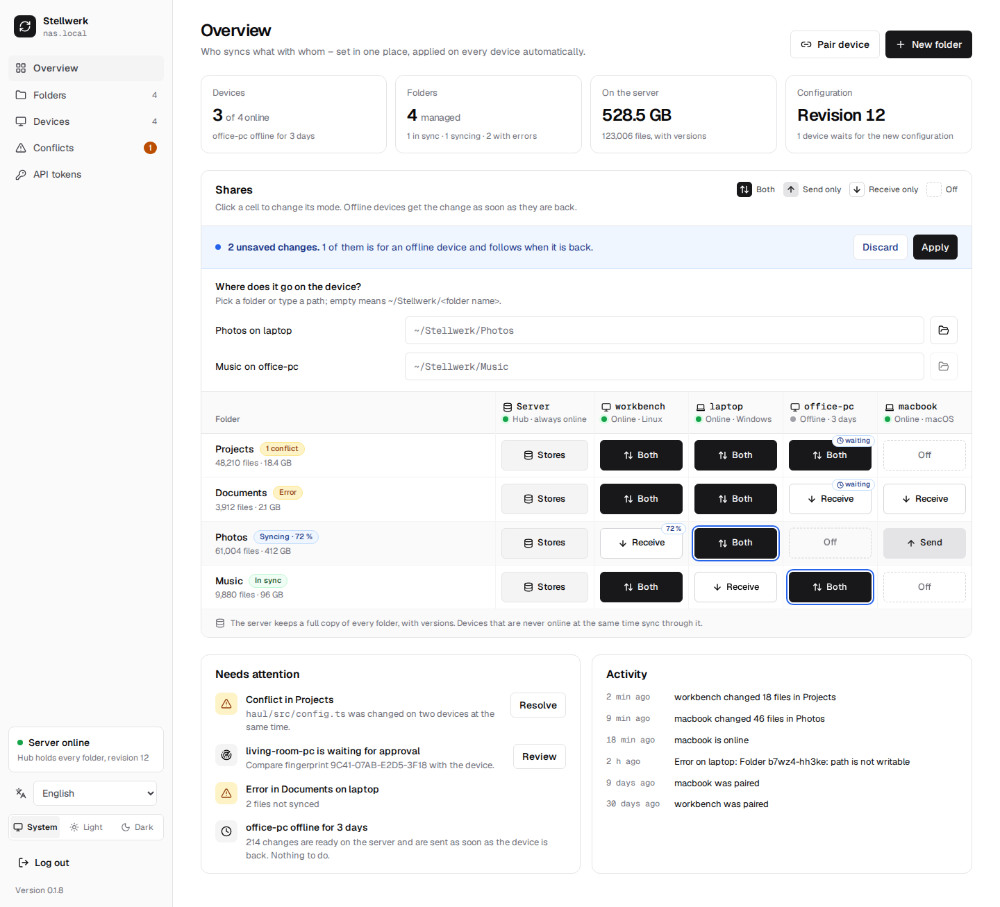
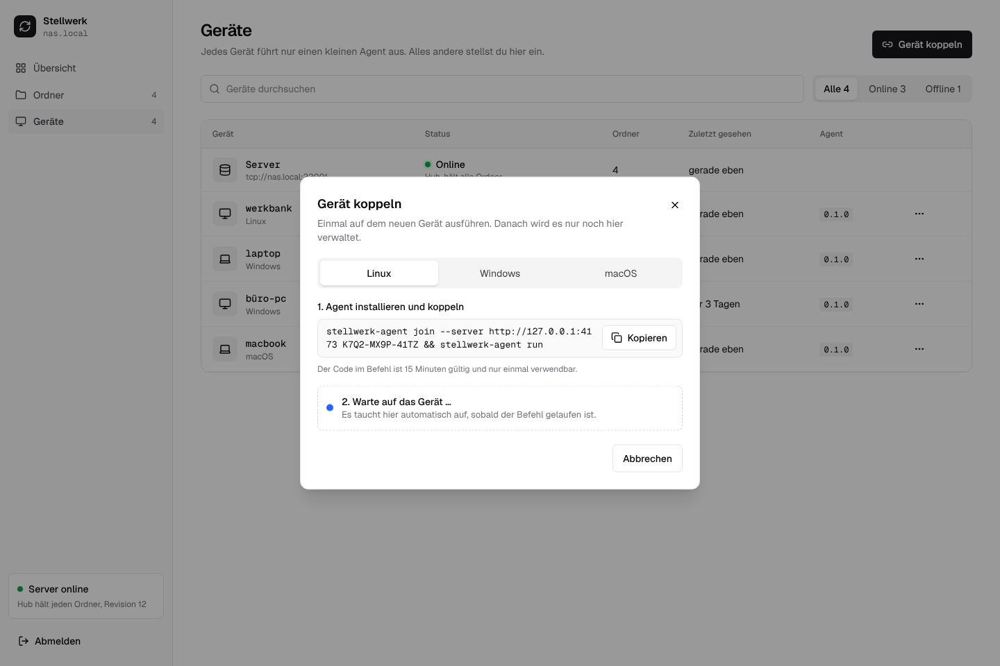
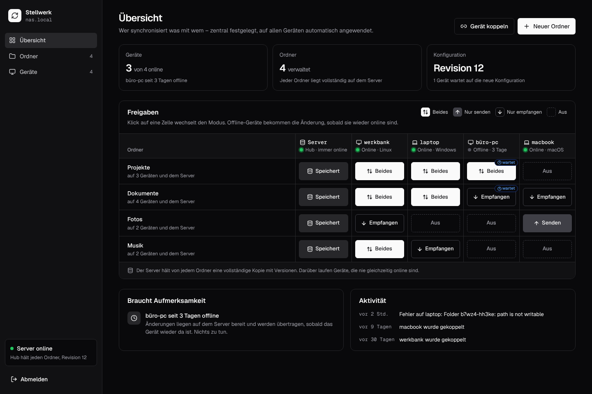
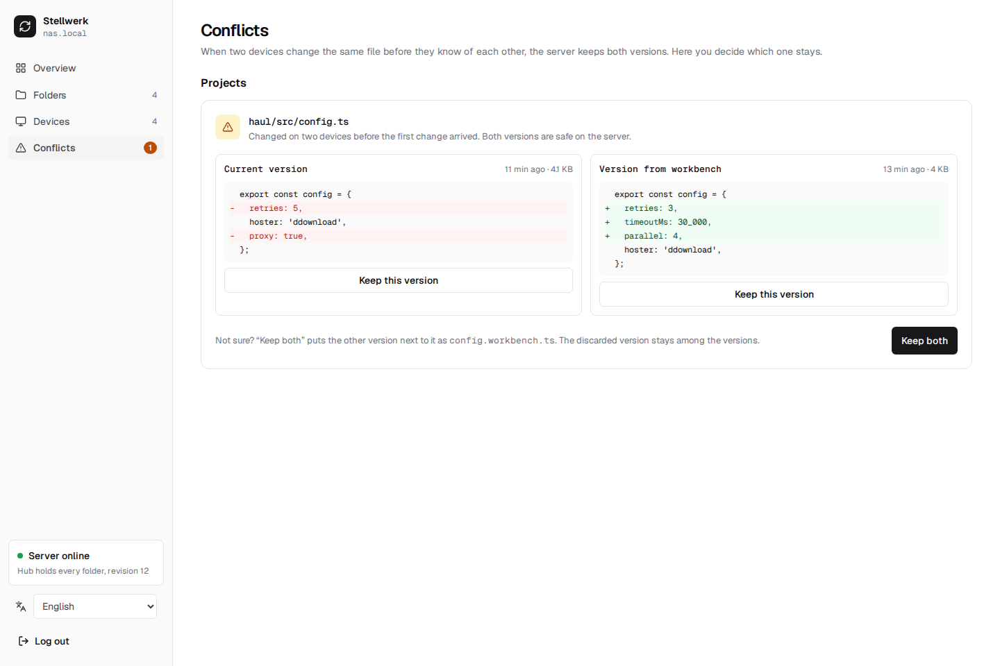

<div align="center">

<h1>Stellwerk: Dateien auf allen Rechnern aktuell halten, gesteuert von einer Stelle</h1>

[English](README.md) · **Deutsch**

**Dateien auf allen Rechnern im Betrieb aktuell halten, ohne Cloud und ohne Fileserver.**<br>
Projektordner, Vorlagen und Pläne im Büro wie auf dem Laptop an der Baustelle; du legst einmal fest, wer welchen Ordner bekommt.<br>
Eine zentrale Weboberfläche für Syncthing auf deinem Server: Open Source, ohne Cloud, ohne auf jedem Rechner „annehmen“ zu klicken.

[](https://github.com/Speicherstadt/stellwerk/actions/workflows/ci.yml)
[](https://github.com/Speicherstadt/stellwerk/releases/latest)
[](https://hub.docker.com/r/tristanteu/stellwerk)
[](https://hub.docker.com/r/tristanteu/stellwerk)
[](https://hub.docker.com/r/tristanteu/stellwerk/tags)
[](https://speicherstadt.app/stellwerk/)
[](LICENSE)


```bash
docker compose up -d && docker compose exec -T stellwerk stellwerk set-password <<< 'ein langes Passwort'
```

[Installation](#-installation) •
[Warum?](#-warum-stellwerk) •
[Funktionen](#-funktionen) •
[Screenshots](#-screenshots) •
[Alternativen](#-stellwerk-und-die-alternativen) •
[FAQ](#-faq) •
[Dokumentation](https://speicherstadt.app/stellwerk/)



</div>

## 💡 Warum Stellwerk?

Der Büro-PC, der Laptop des Chefs und das Notebook auf der Baustelle brauchen dieselben Pläne,
Vorlagen und Projektordner. Ein Cloud-Abo will man dafür nicht, einen Fileserver mit VPN auch
nicht. [Syncthing](https://syncthing.net) gleicht Ordner direkt zwischen den Rechnern ab, hat aber
keine zentrale Verwaltung: Jedes Gerät wird in seiner eigenen Weboberfläche eingerichtet, und jede
neue Freigabe muss auf der Gegenseite angenommen werden. Resilio Sync bietet eine
Verwaltungskonsole, aber nur kommerziell und als Closed Source.

- **Einmal einrichten, auf dem Server**: Gerät koppeln, Ordner, Modus und Pfad wählen; beide
  Seiten werden automatisch eingerichtet.
- **Kein Stillstand, wenn ein PC aus ist**: Der Server ist Mitglied in jedem Ordner und hält eine
  vollständige Kopie, so erreichen Änderungen ein Gerät, sobald es wieder an ist.
- **Klare Übersicht**: Ordner × Geräte als eine Matrix, der Sync-Status auf einen Blick.
- **Syncthing überträgt**: bewährt und verschlüsselt; Stellwerk steuert es nur.

Server: Linux mit Docker oder Podman (amd64 und arm64: ein NAS, ein Mini-PC, ein Raspberry Pi 4/5,
ein VPS). Geräte: Linux, Windows und macOS.

## 🚀 Installation

Auf dem Server eine `compose.yaml` (die Hub-Adresse ist die, unter der deine Geräte den Server
erreichen):

```yaml
services:
  stellwerk:
    image: tristanteu/stellwerk:latest
    restart: unless-stopped
    ports: ["8080:8080", "22001:22001"]   # Weboberfläche und Agenten; Sync-Port des Hubs
    environment:
      STELLWERK_HUB_ADDRESS: tcp://nas.local:22001
    volumes: ["stellwerk:/data"]
volumes:
  stellwerk:
```

```bash
docker compose up -d
docker compose exec -T stellwerk stellwerk set-password <<< 'ein langes Passwort'
```

Öffne `http://nas.local:8080`, klicke auf **Gerät koppeln** und führe den einen angezeigten Befehl
auf jedem Gerät in einem Terminal aus, als normaler Benutzer. Er lädt den Agenten herunter, koppelt
ihn und startet ihn:

```bash
curl -fsSL https://github.com/Speicherstadt/stellwerk/releases/download/vX.Y.Z/install.sh | sh -s -- http://nas.local:8080 K7Q2-MX9P-41TZ
```

Unter Windows zeigt der Dialog dasselbe als PowerShell-Befehl; außerdem gibt es einen Installer,
der nach Adresse und Code fragt. Podman Quadlet, ein Reverse Proxy mit HTTPS, Backups und Updates
stehen in der [Installationsanleitung](https://speicherstadt.app/stellwerk/installation.html); ein
erster Durchlauf Schritt für Schritt steht unter
[Getting started](https://speicherstadt.app/stellwerk/getting-started.html).

> **Vor v1.0**: Jedes [Release](https://github.com/Speicherstadt/stellwerk/releases) veröffentlicht
> das Image `tristanteu/stellwerk` und enthält die Agenten. Alles funktioniert und ist unter Linux,
> Windows und macOS getestet; das Selbst-Update des Agenten unter Windows ist das letzte Stück vor v1.0
> ([Roadmap](https://speicherstadt.app/stellwerk/architecture.html#roadmap)).

## ✨ Funktionen

### 🗺️ Eine Matrix für alles

- **Ordner × Geräte**: Ein Klick pro Zelle wechselt zwischen beiden Richtungen, nur senden, nur
  empfangen und aus.
- **Ordnerauswahl**: Den Ordner auf einem PC wählst du, indem du dich in der Weboberfläche durch
  seine Verzeichnisse klickst, ohne einen Pfad zu tippen.
- **Entwürfe**: Änderungen sammeln sich, bis du sie anwendest, und gehen dann als eine nummerierte
  Revision hinaus.
- **Ausgeschaltete Geräte holen auf**: Ein Gerät, das aus ist, bekommt die neue Konfiguration und
  die Dateien, sobald es wieder an ist; bis dahin zeigt die Zelle „wartet“.

### 🔗 Koppeln, ohne auf jedem PC zu klicken

- **Ein Befehl pro Gerät**: „Gerät koppeln“ zeigt einen Befehl mit einem Code, der 15 Minuten gilt;
  er lädt den Agenten herunter, koppelt ihn und startet ihn, und das Gerät erscheint von selbst in
  der Oberfläche.
- **Auch mit eigener CA**: Hinter einer privaten CA (z. B. Caddys `tls internal`) enthält der Befehl
  den Fingerabdruck der CA, und der Agent vertraut ihr ohne Einrichtung auf dem Gerät.
- **Im LAN ohne Code**: `stellwerk-agent join` findet die Zentrale über mDNS; das Gerät wartet unter
  „Wartende Geräte“, bis du es nach dem Vergleich seines Fingerabdrucks freigibst.
- **Läuft im Hintergrund**: `stellwerk-agent service install` (oder der Windows-Installer) startet
  den Agenten bei der Anmeldung als aktueller Benutzer, ohne Administratorrechte, unter Linux, macOS
  und Windows.
- **Signierte Anmeldung**: Nach dem Koppeln meldet sich der Agent mit seinem eigenen Ed25519-Schlüssel
  an; ein Gerät lässt sich in der Oberfläche sperren oder entfernen.
- **API-Tokens**: Skripte und KI-Assistenten bekommen ein eigenes Token, nur lesend oder mit dem
  Recht, Ordner und Freigaben zu verwalten; Geräte, Koppeln und die Tokens selbst bleiben der
  Anmeldung im Browser vorbehalten.

### 🤖 Claude richtet es ein

- **MCP-Server eingebaut**: Die Zentrale spricht unter `/mcp` das Model Context Protocol. Füge sie
  mit dem Befehl, der beim Anlegen eines Tokens erscheint, zu Claude Code hinzu und sag dann
  „Synchronisiere Game of Thrones vom NAS auf meinen Laptop“.
- **Findet die Dateien für dich**: Der Assistent sucht auf dem Gerät nach dem Namen, legt den Ordner
  an und zeigt eine Vorschau mit der Größe, bevor etwas angewendet wird.
- **Sicher durch Rechte**: Ein lesendes Token kann schauen und eine Vorschau zeigen; nur ein Token
  mit Verwaltungsrecht wendet an, und Geräte, Koppeln und Löschen bleiben der Anmeldung im Browser
  vorbehalten.

### 🗄️ Der Server hat alles

- **Hub in jedem Ordner**: Der Server hält eine vollständige Kopie jedes Ordners, mit Versionen für
  ein Jahr.
- **Live-Status**: Fortschritt je Ordner und Gerät, was ein ausgeschaltetes Gerät bekommen wird, und
  ein Aktivitätsverlauf („Laptop hat 18 Dateien in Projekte geändert“).
- **Konflikte an einer Stelle lösen**: Beide Fassungen nebeneinander mit Diff; behalte eine oder
  beide, die andere bleibt in den Versionen. Jede ältere Version einer Datei lässt sich
  wiederherstellen.
- **Deutsch und Englisch**, nach der Browsersprache oder in der Seitenleiste umgeschaltet.
- **Hell und dunkel**, nach dem System oder in der Seitenleiste umgeschaltet, die auch die
  installierte Version zeigt.
- **Dein Syncthing bleibt deins**: Der Agent bringt sein eigenes Syncthing auf eigenen Ports mit und
  fasst ein Syncthing, das du schon betreibst, nie an.

## 📸 Screenshots

<table>
  <tr>
    <td></td>
    <td></td>
  </tr>
  <tr>
    <td></td>
    <td></td>
  </tr>
  <tr>
    <td></td>
    <td></td>
  </tr>
</table>

## 🔀 Stellwerk und die Alternativen

Stellwerk ist für einen Admin gemacht, der alle Geräte, ob im Betrieb oder die eigenen, über den
eigenen Server abgleichen will.

| | Was es ist | Worin Stellwerk sich unterscheidet |
|---|---|---|
| [Syncthing](https://syncthing.net) allein | Peer-to-Peer-Sync, auf jedem Gerät eingerichtet | eine Stelle, um alle Geräte einzurichten, ein Server, der immer in jedem Ordner ist |
| [Resilio Sync](https://www.resilio.com) mit Management Console | Sync mit zentraler Verwaltung | Open Source und kostenlos; keine kommerzielle Lizenz nötig |
| [Seafile](https://www.seafile.com) | selbst gehosteter Server für Sync und Freigaben mit eigenen Clients | nutzt Syncthing; normale Ordner auf jedem Gerät, kein eigenes Speicherformat |
| [Nextcloud](https://nextcloud.com) | selbst gehostete Cloud-Suite mit Datei-Sync | macht nur Sync, braucht wenig auf dem Server, direkte Übertragung im LAN über Syncthing |
| [SyncWings](https://forum.syncthing.net/t/syncwings-web-ui-for-syncthing-filestash-single-or-multi-user-easy-file-management-looking-for-testers/25202) | Web-Dateimanager auf Syncthing-Instanzen | verwaltet das Syncthing auf jedem Gerät, nicht nur auf dem Server |

## ❓ FAQ

### Gibt es eine zentrale Verwaltungsoberfläche für Syncthing?
Ja, genau dafür ist Stellwerk da: eine Weboberfläche auf deinem Server, die Syncthing auf all deinen
Geräten einrichtet. Releases vor v1.0 sind erschienen, mit dem Image `tristanteu/stellwerk` und den
Agenten; siehe [Installation](#-installation).

### Ändert es mein bestehendes Syncthing?
Nein. Der Agent bringt sein eigenes Syncthing mit eigener Konfiguration und eigenen Ports mit und
lässt ein Syncthing, das du schon betreibst, in Ruhe.

### Kann ich Geräte mit normalem Syncthing einbinden, etwa ein Handy?
Noch nicht. Jedes Gerät braucht den Agenten, und der läuft unter Linux, Windows und macOS. Android
und iOS werden nicht unterstützt.

### Läuft es auf einer Synology, unter Unraid oder auf einem Raspberry Pi?
Überall, wo Docker oder Podman unter Linux mit amd64 oder arm64 läuft: ein Raspberry Pi 4 oder 5 mit
64-Bit-System, Unraid, eine Synology mit Container Manager. Der Server braucht Platz für eine
vollständige Kopie jedes Ordners.

### Brauchen die Geräte Administratorrechte oder offene Ports?
Nein. Der Agent läuft als normaler Benutzer und startet bei der Anmeldung; die Geräte verbinden sich
nur nach außen zum Server. Nur der Server braucht zwei offene Ports: den Webport (hinter HTTPS) und
den Sync-Port des Hubs.

### Sind meine Daten verschlüsselt?
Bei der Übertragung ja: Syncthing verschlüsselt jede Übertragung mit TLS und nimmt nur bekannte
Geräte an; die Weboberfläche und die Verbindung der Agenten laufen über deinen HTTPS-Proxy. Auf dem
Server hält der Hub eine normale Kopie jedes Ordners, schütze den Server also wie die Geräte.
Details unter [Security](https://speicherstadt.app/stellwerk/security.html).

### Was passiert, wenn der Server ausfällt?
Die Geräte behalten ihre Dateien und ihre letzte Konfiguration. Änderungen warten auf jedem Gerät
und werden abgeglichen, sobald der Server wieder da ist.

## 📚 Dokumentation

Die vollständige Dokumentation (auf Englisch), mit Suche, steht unter
**[speicherstadt.app/stellwerk](https://speicherstadt.app/stellwerk/)**.

| | |
|---|---|
| [Getting started](https://speicherstadt.app/stellwerk/getting-started.html) | von null bis zum ersten abgeglichenen Ordner |
| [User guide](https://speicherstadt.app/stellwerk/user-guide.html) | jede Seite der Weboberfläche: Matrix, Geräte, Koppeln, Ordner, Konflikte, Versionen |
| [Installation](https://speicherstadt.app/stellwerk/installation.html) | Docker Compose, Podman Quadlet, Programmdatei; Reverse Proxy und TLS; der Agent auf jedem System; Updates und Backups |
| [Reference](https://speicherstadt.app/stellwerk/reference.html) | jede Option, jeder Port, jede Datei und jede Grenze |
| [Security](https://speicherstadt.app/stellwerk/security.html) | Vertrauensmodell, Verschlüsselung, Anmeldung, Koppeln |
| [Troubleshooting](https://speicherstadt.app/stellwerk/troubleshooting.html) | Logs und die häufigen Probleme |
| [Architecture](https://speicherstadt.app/stellwerk/architecture.html) | Zentrale, Hub, Agent und Engine; Protokoll; Reconciler; Roadmap |
| [Development](https://speicherstadt.app/stellwerk/development.html) | Bauen, Tests, CI, Releases |

## 🛠️ Entwicklung

Braucht Rust (stable) und Bun.

```bash
git clone https://github.com/Speicherstadt/stellwerk && cd stellwerk
bun install && bun run dev:demo   # die Oberfläche mit Demodaten, ohne Server
cargo test                        # lädt einmal das festgelegte Syncthing und startet echte Instanzen
bun run e2e                       # Playwright gegen die Oberfläche im Demomodus
```

Rust-Workspace: `protocol` (Nachrichten, Soll-Zustand), `engine` (Steuerung von Syncthing und
Reconciler), `agent`, `zentrale` (axum, SQLite); React-Oberfläche in `web/`, eingebettet in die
Zentrale. Eine echte Zentrale und einen Agenten lokal betreiben, die Tests und Releases:
[Development](https://speicherstadt.app/stellwerk/development.html).

## 🧩 Mehr von uns

Weitere Open-Source-Apps für deinen eigenen Server, für Buchhaltung, Mail, Office-Dokumente und mehr: **[speicherstadt.app](https://speicherstadt.app)**

## 🤝 Mitmachen

Issues und Pull Requests sind willkommen. Ein guter Fehlerbericht nennt das Betriebssystem, die
Versionen von Stellwerk und Syncthing und was die Zentrale angezeigt hat. Bitte führe
`cargo fmt --all --check`, `cargo clippy --all-targets -- -D warnings`, `cargo test` und
`bun run check` aus, bevor du einen Pull Request öffnest.

---

<div align="center">

⭐ **Gefällt dir Stellwerk?** Ein [Stern auf GitHub](https://github.com/Speicherstadt/stellwerk) hilft anderen, es zu finden.

[Fehler melden](https://github.com/Speicherstadt/stellwerk/issues/new) &nbsp;·&nbsp; [Funktion vorschlagen](https://github.com/Speicherstadt/stellwerk/issues/new)

<sub>Lizenz: <a href="LICENSE">AGPL-3.0</a> · © Tristan Teufel und Contributors<br>
Geänderte Fassungen, die du weitergibst oder für andere betreibst, müssen ihren Quellcode unter der AGPL anbieten. Für IT-Dienstleister: Partnerschaft mit direktem Draht zur Entwicklung, dazu Einrichtung und Support über <a href="https://teufel-it.de">teufel-it.de</a>.<br>
Stellwerk steht in keiner Verbindung zur Syncthing Foundation oder zu Resilio.</sub>

</div>
