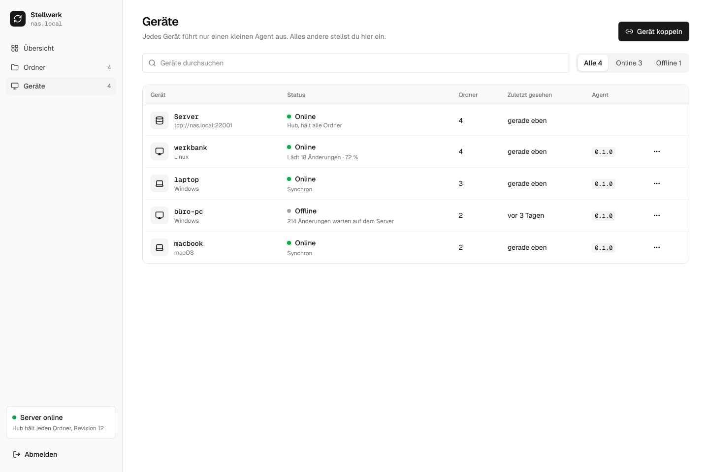
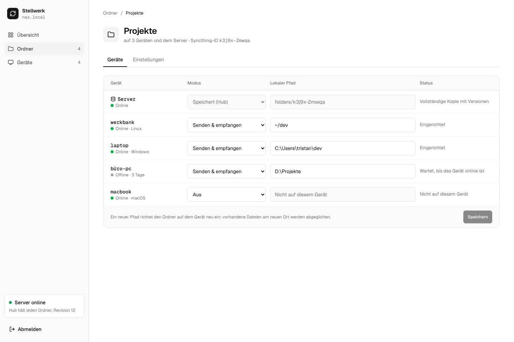

<div align="center">

<h1>Stellwerk: Dateien auf allen Rechnern aktuell halten, gesteuert von einer Stelle</h1>

**Dateien auf allen Rechnern im Betrieb aktuell halten, ohne Cloud und ohne Fileserver.**<br>
Projektordner, Vorlagen und Pläne im Büro wie auf dem Laptop an der Baustelle; du legst einmal fest, wer welchen Ordner bekommt.<br>
Eine zentrale Weboberfläche für Syncthing auf deinem Server: Open Source, ohne Cloud, ohne auf jedem Rechner „annehmen“ zu klicken.

[](https://github.com/Speicherstadt/stellwerk/actions/workflows/ci.yml)
[](https://github.com/Speicherstadt/stellwerk/releases/latest)
[](LICENSE)
[](https://speicherstadt.app/stellwerk/)
[](https://hub.docker.com/r/tristanteu/stellwerk)

[Warum?](#warum-stellwerk) •
[Funktionen](#funktionen) •
[Schnellstart](#schnellstart) •
[FAQ](#faq) •
[Dokumentation](https://speicherstadt.app/stellwerk/) •
[Support und Partnerschaft](#support-und-partnerschaft) •
[Entwicklung](#entwicklung) •
[English](README.md)

<picture>
  <source media="(prefers-color-scheme: dark)" srcset="docs/screenshot-dark.png">
  
</picture>

</div>

## Warum Stellwerk?

Der Büro-PC, der Laptop des Chefs und das Notebook auf der Baustelle brauchen dieselben Pläne,
Vorlagen und Projektordner. Ein Cloud-Abo will man dafür nicht, einen Fileserver mit VPN auch
nicht. [Syncthing](https://syncthing.net) gleicht Ordner direkt zwischen den Rechnern ab, hat aber
keine zentrale Verwaltung: Jedes Gerät wird in seiner eigenen Weboberfläche eingerichtet, und jede
neue Freigabe muss auf der Gegenseite angenommen werden. Resilio Sync bietet eine
Verwaltungskonsole, aber nur kommerziell und als Closed Source.

- **Einmal einrichten, auf dem Server**: Gerät koppeln, Ordner, Modus und Pfad wählen; beide
  Seiten werden automatisch eingerichtet.
- **Kein Stillstand, wenn ein PC aus ist**: Der Server ist Mitglied in jedem Ordner und hält eine
  vollständige Kopie, so erreichen Änderungen ein Gerät, sobald es wieder an ist.
- **Klare Übersicht**: Ordner × Geräte als eine Matrix, der Sync-Status auf einen Blick.
- **Syncthing überträgt**: bewährt und verschlüsselt; Stellwerk steuert es nur.

## Funktionen

Kurz je Bereich; die Details stehen auf der verlinkten Seite der [Dokumentation](https://speicherstadt.app/stellwerk/) (auf Englisch).

| Bereich | Was Stellwerk kann |
|---|---|
| 🗺️ [Eine Matrix für alles](https://speicherstadt.app/stellwerk/user-guide.html#the-matrix) | Ordner × Geräte, ein Klick pro Zelle für beide Richtungen, nur senden, nur empfangen oder aus; den Ordner auf einem PC wählst du per Klick durch seine Verzeichnisse; Änderungen sammeln sich als Entwurf und gehen als eine nummerierte Revision hinaus; ein ausgeschaltetes Gerät holt auf, sobald es wieder an ist |
| 🔗 [Koppeln, ohne auf jedem PC zu klicken](https://speicherstadt.app/stellwerk/user-guide.html#pair-device) | Ein Befehl pro Gerät mit einem Code, der 15 Minuten gilt, auch hinter eigener CA; im LAN ohne Code über mDNS; der Agent startet bei der Anmeldung ohne Administratorrechte unter Linux, macOS und Windows und meldet sich mit seinem eigenen Ed25519-Schlüssel an; API-Tokens für Skripte, nur lesend oder mit dem Recht, Ordner und Freigaben zu verwalten |
| 🤖 [Claude und andere Assistenten (MCP)](https://speicherstadt.app/stellwerk/user-guide.html#claude-code-and-other-assistants-mcp) | MCP-Server unter `/mcp` eingebaut: Der Assistent sucht auf dem Gerät nach dem Namen, legt den Ordner an und zeigt eine Vorschau mit der Größe; nur ein Token mit Verwaltungsrecht wendet an, Geräte, Koppeln und Löschen bleiben der Anmeldung im Browser vorbehalten |
| 🗄️ [Der Server hat alles](https://speicherstadt.app/stellwerk/user-guide.html#overview) | Vollständige Kopie jedes Ordners mit Versionen für ein Jahr; Live-Status je Ordner und Gerät und ein Aktivitätsverlauf; [Konflikte](https://speicherstadt.app/stellwerk/user-guide.html#conflicts) nebeneinander mit Diff, jede ältere Version wiederherstellbar; Deutsch und Englisch, hell und dunkel; das eigene Syncthing des Agenten fasst eines, das du schon betreibst, nie an |

## Screenshots

<table>
  <tr>
    <td width="50%"><br><sub><b>Geräte</b>: online oder offline, ihre Ordner und die Version des Agenten</sub></td>
    <td width="50%"><br><sub><b>Gerät koppeln</b>: ein Befehl mit einem Einmal-Code</sub></td>
  </tr>
  <tr>
    <td width="50%"><br><sub><b>Ordner</b>: Modus und lokaler Pfad auf jedem Gerät</sub></td>
    <td width="50%"><br><sub><b>Konflikt</b>: beide Fassungen nebeneinander, eine oder beide behalten</sub></td>
  </tr>
</table>

## Stellwerk und die Alternativen

Stellwerk ist für einen Admin gemacht, der alle Geräte, ob im Betrieb oder die eigenen, über den
eigenen Server abgleichen will.

| | Was es ist | Worin Stellwerk sich unterscheidet |
|---|---|---|
| [Syncthing](https://syncthing.net) allein | Peer-to-Peer-Sync, auf jedem Gerät eingerichtet | eine Stelle, um alle Geräte einzurichten, ein Server, der immer in jedem Ordner ist |
| [Resilio Sync](https://www.resilio.com) mit Management Console | Sync mit zentraler Verwaltung | Open Source und kostenlos; keine kommerzielle Lizenz nötig |
| [Seafile](https://www.seafile.com) | selbst gehosteter Server für Sync und Freigaben mit eigenen Clients | nutzt Syncthing; normale Ordner auf jedem Gerät, kein eigenes Speicherformat |
| [Nextcloud](https://nextcloud.com) | selbst gehostete Cloud-Suite mit Datei-Sync | macht nur Sync; direkte Übertragung im LAN über Syncthing |
| [SyncWings](https://forum.syncthing.net/t/syncwings-web-ui-for-syncthing-filestash-single-or-multi-user-easy-file-management-looking-for-testers/25202) | Web-Dateimanager auf Syncthing-Instanzen | verwaltet das Syncthing auf jedem Gerät, nicht nur auf dem Server |

## Schnellstart

Stellwerk läuft als ein Container (`tristanteu/stellwerk`, amd64 und arm64) auf einem Linux-Server mit Docker oder Podman:
ein NAS, ein Mini-PC, ein Raspberry Pi 4/5, ein VPS. Geräte: Linux, Windows und macOS.

### 1. Von einem Agenten aufsetzen lassen

Gib Claude Code oder einem anderen Coding-Agenten dieses Repository und SSH-Zugang zu deinem Server und sag:
„Setz Stellwerk auf meinem Server auf, nach der [Installationsanleitung](https://speicherstadt.app/stellwerk/installation.html).“
Läuft es, füge den MCP-Server der Zentrale mit dem Befehl, der beim Anlegen eines Tokens erscheint,
zu Claude Code hinzu und sag dann „Synchronisiere Game of Thrones vom NAS auf meinen Laptop“.

### 2. Manuell

Auf dem Server eine `compose.yaml` (die Hub-Adresse ist die, unter der deine Geräte den Server
erreichen):

```yaml
services:
  stellwerk:
    image: tristanteu/stellwerk:latest
    restart: unless-stopped
    ports: ["8080:8080", "22001:22001"]   # Weboberfläche und Agenten; Sync-Port des Hubs
    environment:
      STELLWERK_HUB_ADDRESS: tcp://nas.local:22001
    volumes: ["stellwerk:/data"]
volumes:
  stellwerk:
```

```bash
docker compose up -d
docker compose exec -T stellwerk stellwerk set-password <<< 'ein langes Passwort'
```

Öffne `http://nas.local:8080`, klicke auf **Gerät koppeln** und führe den einen angezeigten Befehl
auf jedem Gerät in einem Terminal aus, als normaler Benutzer. Er lädt den Agenten herunter, koppelt
ihn und startet ihn:

```bash
curl -fsSL https://github.com/Speicherstadt/stellwerk/releases/download/vX.Y.Z/install.sh | sh -s -- http://nas.local:8080 K7Q2-MX9P-41TZ
```

Unter Windows zeigt der Dialog dasselbe als PowerShell-Befehl; außerdem gibt es einen Installer,
der nach Adresse und Code fragt. Podman Quadlet, ein Reverse Proxy mit HTTPS, Backups und Updates
stehen in der [Installationsanleitung](https://speicherstadt.app/stellwerk/installation.html); ein
erster Durchlauf Schritt für Schritt steht unter
[Getting started](https://speicherstadt.app/stellwerk/getting-started.html).

> **Vor v1.0**: Jedes [Release](https://github.com/Speicherstadt/stellwerk/releases) veröffentlicht
> das Image `tristanteu/stellwerk` und enthält die Agenten. Alles funktioniert und ist unter Linux,
> Windows und macOS getestet; das Selbst-Update des Agenten unter Windows ist das letzte Stück vor v1.0
> ([Roadmap](https://speicherstadt.app/stellwerk/architecture.html#roadmap)).

## FAQ

<details>
<summary><b>Gibt es eine zentrale Verwaltungsoberfläche für Syncthing?</b></summary>

Ja, genau dafür ist Stellwerk da: eine Weboberfläche auf deinem Server, die Syncthing auf all deinen
Geräten einrichtet. Releases vor v1.0 sind erschienen, mit dem Image `tristanteu/stellwerk` und den
Agenten; siehe [Schnellstart](#schnellstart).
</details>

<details>
<summary><b>Ändert es mein bestehendes Syncthing?</b></summary>

Nein. Der Agent bringt sein eigenes Syncthing mit eigener Konfiguration und eigenen Ports mit und
lässt ein Syncthing, das du schon betreibst, in Ruhe.
</details>

<details>
<summary><b>Kann ich Geräte mit normalem Syncthing einbinden, etwa ein Handy?</b></summary>

Noch nicht. Jedes Gerät braucht den Agenten, und der läuft unter Linux, Windows und macOS. Android
und iOS werden nicht unterstützt.
</details>

<details>
<summary><b>Läuft es auf einer Synology, unter Unraid oder auf einem Raspberry Pi?</b></summary>

Überall, wo Docker oder Podman unter Linux mit amd64 oder arm64 läuft: ein Raspberry Pi 4 oder 5 mit
64-Bit-System, Unraid, eine Synology mit Container Manager. Der Server braucht Platz für eine
vollständige Kopie jedes Ordners.
</details>

<details>
<summary><b>Brauchen die Geräte Administratorrechte oder offene Ports?</b></summary>

Nein. Der Agent läuft als normaler Benutzer und startet bei der Anmeldung; die Geräte verbinden sich
nur nach außen zum Server. Nur der Server braucht zwei offene Ports: den Webport (hinter HTTPS) und
den Sync-Port des Hubs.
</details>

<details>
<summary><b>Sind meine Daten verschlüsselt?</b></summary>

Bei der Übertragung ja: Syncthing verschlüsselt jede Übertragung mit TLS und nimmt nur bekannte
Geräte an; die Weboberfläche und die Verbindung der Agenten laufen über deinen HTTPS-Proxy. Auf dem
Server hält der Hub eine normale Kopie jedes Ordners, schütze den Server also wie die Geräte.
Details unter [Security](https://speicherstadt.app/stellwerk/security.html).
</details>

<details>
<summary><b>Was passiert, wenn der Server ausfällt?</b></summary>

Die Geräte behalten ihre Dateien und ihre letzte Konfiguration. Änderungen warten auf jedem Gerät
und werden abgeglichen, sobald der Server wieder da ist.
</details>

## Dokumentation

Alles im Detail (auf Englisch), mit Suche: **[speicherstadt.app/stellwerk](https://speicherstadt.app/stellwerk/)**. Jede Funktion oben verlinkt ihre Seite; dazu kommen:

- **Einstieg:** [Getting started](https://speicherstadt.app/stellwerk/getting-started.html) (von null bis zum ersten abgeglichenen Ordner),
  [Installation](https://speicherstadt.app/stellwerk/installation.html) (Docker Compose, Podman Quadlet, Programmdatei; Reverse Proxy und TLS; der Agent auf jedem System; Updates und Backups)
- **Nachschlagen:** [Reference](https://speicherstadt.app/stellwerk/reference.html) (jede Option, jeder Port, jede Datei und jede Grenze),
  [Security](https://speicherstadt.app/stellwerk/security.html) (Vertrauensmodell, Verschlüsselung, Anmeldung, Koppeln),
  [Troubleshooting](https://speicherstadt.app/stellwerk/troubleshooting.html) (Logs und die häufigen Probleme)
- **Hintergrund:** [Architecture](https://speicherstadt.app/stellwerk/architecture.html) (Zentrale, Hub, Agent und Engine; Protokoll; Reconciler; Roadmap),
  [Development](https://speicherstadt.app/stellwerk/development.html) (Bauen, Tests, CI, Releases)

## Entwicklung


Braucht Rust (stable) und Bun.

```bash
git clone https://github.com/Speicherstadt/stellwerk && cd stellwerk
bun install && bun run dev:demo   # die Oberfläche mit Demodaten, ohne Server
cargo test                        # lädt einmal das festgelegte Syncthing und startet echte Instanzen
bun run e2e                       # Playwright gegen die Oberfläche im Demomodus
```

Rust-Workspace: `protocol` (Nachrichten, Soll-Zustand), `engine` (Steuerung von Syncthing und
Reconciler), `agent`, `zentrale` (axum, SQLite); React-Oberfläche in `web/`, eingebettet in die
Zentrale. Eine echte Zentrale und einen Agenten lokal betreiben, die Tests und Releases:
[Development](https://speicherstadt.app/stellwerk/development.html).

## Mehr von uns

Weitere Open-Source-Apps für deinen eigenen Server, etwa für Buchhaltung, Mail, Office-Dokumente und mehr: **[speicherstadt.app](https://speicherstadt.app)**

## Support und Partnerschaft

Stellwerk ist kostenlos (AGPL). Wer es nicht selbst einrichten oder betreiben will, bekommt Hilfe von den
Entwicklern:

- **Einrichtung** auf deinem Server
- **Support** bei Updates, Backups und Fragen im Betrieb
- **Betrieb** von Stellwerk als gehosteter Dienst, ohne eigenen Server
- **Partnerschaft für IT-Dienstleister**, die Stellwerk bei ihren Kunden einrichten: direkter Draht zur Entwicklung

Mehr auf [speicherstadt.app](https://speicherstadt.app/#support), Anfragen an [info@teufel-it.de](mailto:info@teufel-it.de).

## Mitwirken

Issues und Pull Requests sind willkommen. Ein guter Fehlerbericht nennt das Betriebssystem, die
Versionen von Stellwerk und Syncthing und was die Zentrale angezeigt hat. Bitte führe
`cargo fmt --all --check`, `cargo clippy --all-targets -- -D warnings`, `cargo test` und
`bun run check` aus, bevor du einen Pull Request öffnest.

## Sterne im Verlauf

<a href="https://www.star-history.com/#Speicherstadt/stellwerk&Date">
  <picture>
    <source media="(prefers-color-scheme: dark)" srcset="https://api.star-history.com/svg?repos=Speicherstadt/stellwerk&type=Date&theme=dark">
    
  </picture>
</a>

---

<div align="center">

⭐ **Gefällt dir Stellwerk?** Ein [Stern auf GitHub](https://github.com/Speicherstadt/stellwerk) hilft anderen, es zu finden.

[Fehler melden](https://github.com/Speicherstadt/stellwerk/issues/new) &nbsp;·&nbsp; [Funktion vorschlagen](https://github.com/Speicherstadt/stellwerk/issues/new)

<sub>Lizenz: <a href="LICENSE">AGPL-3.0</a> · © Tristan Teufel und Contributors · <a href="README.md">English</a><br>
Geänderte Fassungen, die du weitergibst oder für andere betreibst, müssen ihren Quellcode unter der AGPL anbieten.<br>
Stellwerk steht in keiner Verbindung zur Syncthing Foundation, zu Resilio, Seafile, Nextcloud oder SyncWings; die Namen sind Marken ihrer Inhaber.</sub>

</div>
