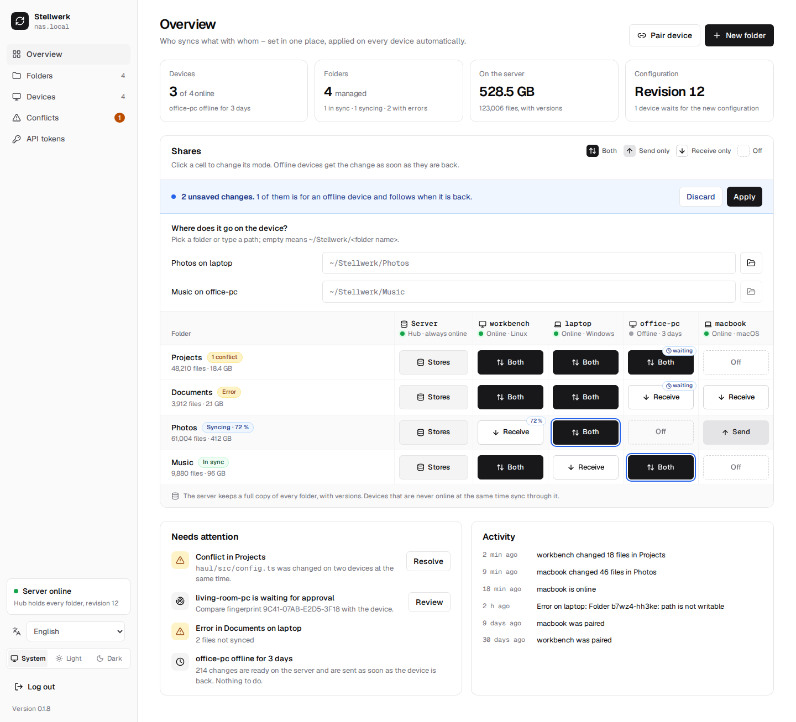
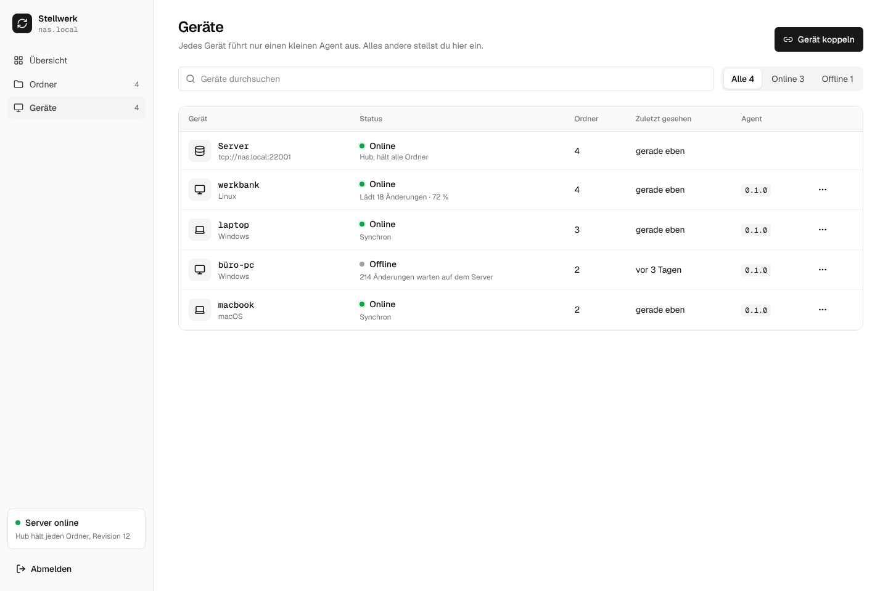
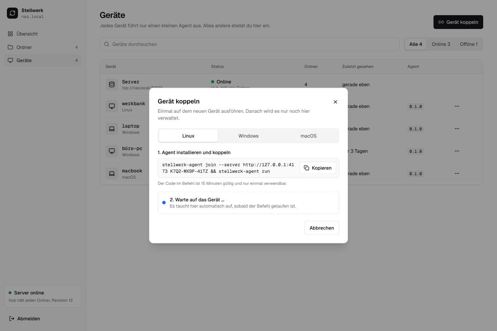
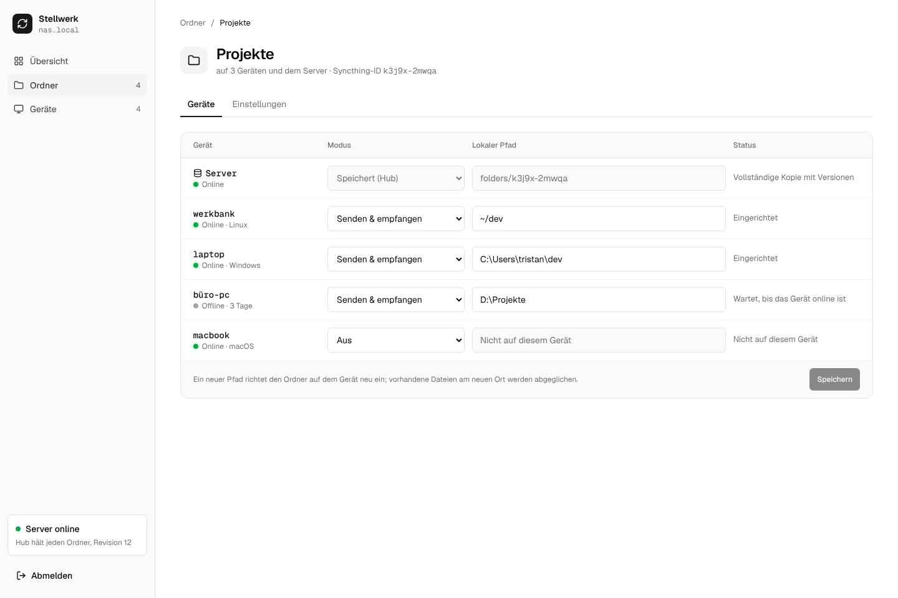
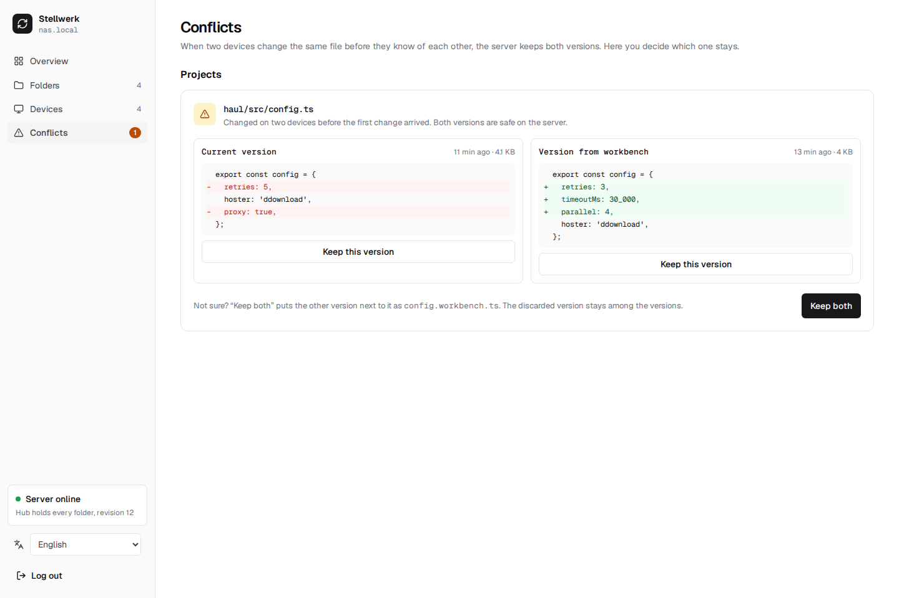

<div align="center">

<h1>Stellwerk: central web UI to manage Syncthing on all your devices</h1>

**Self-hosted control center for Syncthing: pair devices, share folders and set paths for every PC from one web UI.**<br>
A small agent on each device brings its own Syncthing and follows what the server says; a hub Syncthing on the server keeps a full copy of every folder.<br>
Open source, no cloud, no clicking "accept" on every machine.

[](https://github.com/Speicherstadt/stellwerk/actions/workflows/ci.yml)
[](https://github.com/Speicherstadt/stellwerk/releases/latest)
[](LICENSE)
[](https://speicherstadt.app/stellwerk/)
[](https://hub.docker.com/r/tristanteu/stellwerk)

[Why?](#why-stellwerk) •
[Features](#features) •
[Quick start](#quick-start) •
[FAQ](#faq) •
[Documentation](https://speicherstadt.app/stellwerk/) •
[Development](#development) •
[Deutsch](README.de.md)

<picture>
  <source media="(prefers-color-scheme: dark)" srcset="docs/screenshot-dark.png">
  
</picture>

</div>

## Why Stellwerk?

The office PC, the boss's laptop and the notebook at the site need the same plans, templates and
project folders, without a cloud subscription or a file server behind a VPN. Syncthing syncs
folders directly between the computers, but it has no central management: every device is set up in its own web UI, and every new
share has to be accepted on the other side. Resilio Sync offers a management console, but only
commercially and closed source.

- **Configure once, on the server**: pair a device, pick folders, modes and paths; both sides
  are set up automatically.
- **No standstill when a PC is off**: the server is a member of every folder and holds a full
  copy, so changes reach a device as soon as it is back.
- **A clear overview**: folders × devices as one matrix, sync status at a glance.
- **Syncthing does the syncing**: proven, encrypted transfer; Stellwerk only steers it.

## Features

Briefly per area; the details are on the linked page of the [documentation](https://speicherstadt.app/stellwerk/).

| Area | What Stellwerk does |
|---|---|
| 🗺️ [One matrix for everything](https://speicherstadt.app/stellwerk/user-guide.html#the-matrix) | Folders × devices, one click per cell for both directions, send only, receive only or off; pick the folder on a PC by clicking through its directories; changes collect as a draft and go out as one numbered revision; a device that is off catches up when it is back |
| 🔗 [Pairing without clicking on every PC](https://speicherstadt.app/stellwerk/user-guide.html#pair-device) | One command per device with a code valid for 15 minutes, also behind your own CA; in the LAN without a code over mDNS; the agent starts at login without admin rights on Linux, macOS and Windows and signs in with its own Ed25519 key; API tokens for scripts, read-only or allowed to manage folders and shares |
| 🤖 [Claude and other assistants (MCP)](https://speicherstadt.app/stellwerk/user-guide.html#claude-code-and-other-assistants-mcp) | MCP server built in at `/mcp`: the assistant searches the device by name, creates the folder and shows a preview with the size; only a "manage" token applies, and devices, pairing and deleting stay with the browser login |
| 🗄️ [The server holds everything](https://speicherstadt.app/stellwerk/user-guide.html#overview) | Full copy of each folder with versions for a year; live status per folder and device and an activity feed; [conflicts](https://speicherstadt.app/stellwerk/user-guide.html#conflicts) side by side with a diff, any older version restorable; German and English, light and dark; the agent's own Syncthing never touches one you already run |

## Screenshots

<table>
  <tr>
    <td width="50%"><br><sub><b>Devices</b>: online or offline, their folders and the agent version</sub></td>
    <td width="50%"><br><sub><b>Pair device</b>: one command with a one-time code</sub></td>
  </tr>
  <tr>
    <td width="50%"><br><sub><b>Folder</b>: mode and local path on every device</sub></td>
    <td width="50%"><br><sub><b>Conflict</b>: both versions side by side, keep one or both</sub></td>
  </tr>
</table>

## Stellwerk and the alternatives

Stellwerk is made for one admin who wants all the devices, in a business or their own, synced
through their own server.

| | What it is | Where Stellwerk differs |
|---|---|---|
| [Syncthing](https://syncthing.net) alone | peer-to-peer sync, configured on each device | one place to configure all devices, a server that is always in every folder |
| [Resilio Sync](https://www.resilio.com) with Management Console | sync with central management | open source and free; no commercial license needed |
| [Seafile](https://www.seafile.com) | self-hosted file sync and share server with its own clients | uses Syncthing; plain folders on every device, no own storage format |
| [Nextcloud](https://nextcloud.com) | self-hosted cloud suite with file sync | does only sync; direct LAN transfer through Syncthing |
| [SyncWings](https://forum.syncthing.net/t/syncwings-web-ui-for-syncthing-filestash-single-or-multi-user-easy-file-management-looking-for-testers/25202) | web file manager on top of Syncthing instances | manages the Syncthing on every device, not only on the server |

## Quick start

Stellwerk runs as one container (`tristanteu/stellwerk`, amd64 and arm64) on a Linux server with Docker or Podman:
a NAS, a mini PC, a Raspberry Pi 4/5, a VPS. Devices: Linux, Windows and macOS.

### 1. Let an agent set it up

Give Claude Code or another coding agent this repository and SSH access to your server and say:
"Set up Stellwerk on my server, following the [installation guide](https://speicherstadt.app/stellwerk/installation.html)."
Once it runs, add the Zentrale's MCP server to Claude Code with the command shown when you create a
token, then say "Sync Game of Thrones from the NAS to my laptop".

### 2. Manually

On the server, a `compose.yaml` (the hub address is where your devices reach the server):

```yaml
services:
  stellwerk:
    image: tristanteu/stellwerk:latest
    restart: unless-stopped
    ports: ["8080:8080", "22001:22001"]   # web UI and agents; sync port of the hub
    environment:
      STELLWERK_HUB_ADDRESS: tcp://nas.local:22001
    volumes: ["stellwerk:/data"]
volumes:
  stellwerk:
```

```bash
docker compose up -d
docker compose exec -T stellwerk stellwerk set-password <<< 'a long password'
```

Open `http://nas.local:8080`, click **Pair device** and run the one command it shows in a terminal
on each device, as the normal user. It downloads the agent, pairs it and starts it:

```bash
curl -fsSL https://github.com/Speicherstadt/stellwerk/releases/download/vX.Y.Z/install.sh | sh -s -- http://nas.local:8080 K7Q2-MX9P-41TZ
```

On Windows the dialog shows the same as a PowerShell command; there is also an installer that
asks for the address and the code. Podman Quadlet, a
reverse proxy with HTTPS, backups and updates are in the
[installation guide](https://speicherstadt.app/stellwerk/installation.html); a step-by-step
first run is in [Getting started](https://speicherstadt.app/stellwerk/getting-started.html).

> **Before v1.0**: every [release](https://github.com/Speicherstadt/stellwerk/releases) publishes the
> image `tristanteu/stellwerk` and carries the agents. Everything works and is tested on Linux,
> Windows and macOS; the self-update of the agent on Windows is the last piece before v1.0
> ([roadmap](https://speicherstadt.app/stellwerk/architecture.html#roadmap)).

No server or IT of your own? Stellwerk is available hosted on request or through an IT service provider from the [partner programme](https://speicherstadt.app/en/partner/).

## FAQ

<details>
<summary><b>Is there a central management UI for Syncthing?</b></summary>

Yes, that is what Stellwerk is for: one web UI on your server that configures Syncthing on all
your devices. Releases before v1.0 are out, with the image `tristanteu/stellwerk` and the agents;
see [Quick start](#quick-start).
</details>

<details>
<summary><b>Does it change my existing Syncthing?</b></summary>

No. The agent brings its own Syncthing with its own configuration and ports and leaves a
Syncthing you already run alone.
</details>

<details>
<summary><b>Can I add devices that run plain Syncthing, like a phone?</b></summary>

Not yet. Every device needs the agent, which runs on Linux, Windows and macOS. Android and iOS
are not supported.
</details>

<details>
<summary><b>Does it run on a Synology, Unraid or Raspberry Pi?</b></summary>

Anywhere Docker or Podman runs on Linux with amd64 or arm64: a Raspberry Pi 4 or 5 with a 64-bit
OS, Unraid, a Synology with Container Manager. The server needs disk space for a full copy of
every folder.
</details>

<details>
<summary><b>Do the devices need admin rights or open ports?</b></summary>

No. The agent runs as the normal user and starts at login; devices only connect out to the
server. Only the server needs two ports open: the web port (behind HTTPS) and the hub's sync
port.
</details>

<details>
<summary><b>Is my data encrypted?</b></summary>

In transit, yes: Syncthing encrypts every transfer with TLS and accepts only known devices; the
web UI and the agents' connection go through your HTTPS proxy. On the server, the hub keeps a
normal copy of every folder, so protect the server like the devices. Details in
[Security](https://speicherstadt.app/stellwerk/security.html).
</details>

<details>
<summary><b>What happens if the server is down?</b></summary>

The devices keep their files and their last configuration. Changes wait on each device and sync
as soon as the server is back.
</details>

## Documentation

Everything in detail, with search: **[speicherstadt.app/stellwerk](https://speicherstadt.app/stellwerk/)**. Every feature above links its page; in addition:

- **Getting started:** [Getting started](https://speicherstadt.app/stellwerk/getting-started.html) (from nothing to a first synced folder),
  [Installation](https://speicherstadt.app/stellwerk/installation.html) (Docker Compose, Podman Quadlet, binary; reverse proxy and TLS; the agent on each OS; updates and backups)
- **Reference:** [Reference](https://speicherstadt.app/stellwerk/reference.html) (every option, port, file and limit),
  [Security](https://speicherstadt.app/stellwerk/security.html) (trust model, encryption, login, pairing),
  [Troubleshooting](https://speicherstadt.app/stellwerk/troubleshooting.html) (logs and the common problems)
- **Background:** [Architecture](https://speicherstadt.app/stellwerk/architecture.html) (Zentrale, hub, agent and engine; protocol; reconciler; roadmap),
  [Development](https://speicherstadt.app/stellwerk/development.html) (building, tests, CI, releases)

## Development

[](https://www.rust-lang.org)
[](https://www.typescriptlang.org)
[](https://react.dev)
[](https://tanstack.com)
[](https://tailwindcss.com)
[](https://vite.dev)
[](https://github.com/launchbadge/sqlx)

Requires Rust (stable) and Bun.

```bash
git clone https://github.com/Speicherstadt/stellwerk && cd stellwerk
bun install && bun run dev:demo   # the UI on demo data, no server needed
cargo test                        # downloads the pinned Syncthing once and runs real instances
bun run e2e                       # Playwright against the UI in demo mode
```

Rust workspace: `protocol` (messages, desired state), `engine` (Syncthing control and
reconciler), `agent`, `zentrale` (axum, SQLite); React UI in `web/`, embedded into the Zentrale.
Running a real Zentrale and agent locally, the tests and releases:
[Development](https://speicherstadt.app/stellwerk/development.html).

## More from us

More open-source apps for your own server, covering accounting, email, office documents and more: **[speicherstadt.app](https://speicherstadt.app)**

## Contributing

Issues and pull requests are welcome. A good bug report names the OS, the Stellwerk and Syncthing
versions and what the Zentrale showed. Please run `cargo fmt --all --check`,
`cargo clippy --all-targets -- -D warnings`, `cargo test` and `bun run check` before opening a pull
request.

## Star history

<a href="https://www.star-history.com/#Speicherstadt/stellwerk&Date">
  <picture>
    <source media="(prefers-color-scheme: dark)" srcset="https://api.star-history.com/svg?repos=Speicherstadt/stellwerk&type=Date&theme=dark">
    
  </picture>
</a>

---

<div align="center">

⭐ **Like Stellwerk?** A [star on GitHub](https://github.com/Speicherstadt/stellwerk) helps others find it.

[Report a bug](https://github.com/Speicherstadt/stellwerk/issues/new) &nbsp;·&nbsp; [Request a feature](https://github.com/Speicherstadt/stellwerk/issues/new)

<sub>License: <a href="LICENSE">AGPL-3.0</a> · © Tristan Teufel and contributors · <a href="README.de.md">Deutsch</a><br>
Changed versions you pass on or run for others must offer their source code under the AGPL.<br>
For IT service providers and hosters: <a href="https://speicherstadt.app/en/partner/">partner programme</a>.<br>
Stellwerk is not affiliated with the Syncthing Foundation, Resilio, Seafile, Nextcloud or SyncWings; the names are trademarks of their owners.</sub>

</div>
