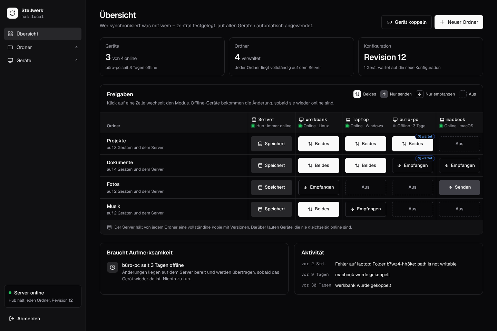

<div align="center">

<h1>Stellwerk: central web UI to manage Syncthing on all your devices</h1>

**Self-hosted control center for Syncthing: pair devices, share folders and set paths for every PC from one web UI.**<br>
A small agent on each device brings its own Syncthing and follows what the server says; a hub Syncthing on the server keeps a full copy of every folder.<br>
Open source, no cloud, no clicking "accept" on every machine.

[](https://github.com/firsttris/stellwerk/actions/workflows/ci.yml)
[](https://firsttris.github.io/stellwerk/)
[](LICENSE)


[Status](#-status) •
[Why](#-why-stellwerk) •
[Features](#-features) •
[Screenshots](#-screenshots) •
[Alternatives](#-stellwerk-and-the-alternatives) •
[FAQ](#-faq) •
[Documentation](https://firsttris.github.io/stellwerk/)


</div>

## 🚧 Status

Early development. Phases 1 and 2 work: Zentrale with web UI and hub Syncthing, agent, pairing with a
one-time code and the folder × device matrix, tested with three real Syncthing instances and a
device that is offline while things change; live status, conflicts, versions and ignore patterns
on top. The Zentrale runs as a container (Docker Compose or Podman Quadlet); until v1.0 the image
and the agent are built from source
([installation](https://firsttris.github.io/stellwerk/installation.html)). Next: a week of daily
use, then installers and self-update. The
[roadmap](https://firsttris.github.io/stellwerk/architecture.html#roadmap) has the details.

## 💡 Why Stellwerk?

Syncthing has no central management: every device is set up in its own web UI, and every new
share has to be accepted on the other side. Resilio Sync offers a management console, but only
commercially and closed source.

- **Configure once, on the server**: pair a device, pick folders, modes and paths; both sides
  are set up automatically.
- **No standstill when a PC is off**: the server is a member of every folder and holds a full
  copy, so changes reach a device as soon as it is back.
- **A clear overview**: folders × devices as one matrix, sync status at a glance.
- **Syncthing does the syncing**: proven, encrypted transfer; Stellwerk only steers it.

Server: Linux with Docker or Podman. Devices: Linux, Windows and macOS.

## ✨ Features

### 🗺️ One matrix for everything

- **Folders × devices**: one click per cell switches between both directions, send only, receive
  only and off.
- **Drafts**: changes collect until you apply them, then go out as one numbered revision.
- **Offline devices catch up**: a device that is off gets the new configuration and the files as
  soon as it is back; the cell says "wartet" until then.

### 🔗 Pairing without clicking on every PC

- **One-time code**: "Gerät koppeln" shows a command with a code valid for 15 minutes; the device
  appears in the UI by itself.
- **In the LAN without a code**: `stellwerk-agent join` finds the Zentrale over mDNS; the device
  waits under "Wartende Geräte" until you approve it, after comparing its fingerprint.
- **Signed sign-in**: after pairing, the agent signs in with its own Ed25519 key; a device can be
  blocked or removed in the UI.

### 🗄️ The server holds everything

- **Hub in every folder**: the server keeps a full copy of each folder, with versions for a year.
- **Live status**: progress per folder and device, what an offline device will get, and an
  activity feed ("laptop changed 18 files in Projekte").
- **Conflicts solved in one place**: both versions side by side with a diff; keep one or both,
  the other stays in the versions. Any older version of a file can be restored.
- **German and English**, following the browser or switched in the sidebar.
- **Your Syncthing stays yours**: the agent brings its own Syncthing on its own ports and never
  touches a Syncthing you already run.

## 📸 Screenshots

<table>
  <tr>
    <td></td>
    <td></td>
  </tr>
  <tr>
    <td></td>
    <td></td>
  </tr>
  <tr>
    <td></td>
    <td></td>
  </tr>
</table>

## 🔀 Stellwerk and the alternatives

Stellwerk is made for one admin who wants all their own devices synced through their own server.

| | What it is | Where Stellwerk differs |
|---|---|---|
| [Syncthing](https://syncthing.net) alone | peer-to-peer sync, configured on each device | one place to configure all devices, a server that is always in every folder |
| [Resilio Sync](https://www.resilio.com) with Management Console | sync with central management | open source and free; no commercial license needed |
| [Seafile](https://www.seafile.com) | self-hosted file sync and share server with its own clients | uses Syncthing; plain folders on every device, no own storage format |
| [Nextcloud](https://nextcloud.com) | self-hosted cloud suite with file sync | does only sync, light on the server, direct LAN transfer through Syncthing |
| [SyncWings](https://forum.syncthing.net/t/syncwings-web-ui-for-syncthing-filestash-single-or-multi-user-easy-file-management-looking-for-testers/25202) | web file manager on top of Syncthing instances | manages the Syncthing on every device, not only on the server |

## ❓ FAQ

### Is there a central management UI for Syncthing?
That is what Stellwerk is for. There is no release yet, but it can be built from source; see
[Status](#-status).

### Does it change my existing Syncthing?
No. The agent brings its own Syncthing with its own configuration and ports and leaves a
Syncthing you already run alone.

## 📚 Documentation

The documentation is at **[firsttris.github.io/stellwerk](https://firsttris.github.io/stellwerk/)**.

| | |
|---|---|
| [Installation](https://firsttris.github.io/stellwerk/installation.html) | building, running the Zentrale, pairing a device |
| [Architecture](https://firsttris.github.io/stellwerk/architecture.html) | Zentrale, hub, agent and engine; protocol; reconciler; roadmap |

## 🛠️ Development

Requires Rust (stable), Node 22 and pnpm.

```bash
git clone https://github.com/firsttris/stellwerk && cd stellwerk
pnpm install && pnpm dev:demo   # the UI on demo data, no server needed
cargo test                      # downloads the pinned Syncthing once and runs real instances
pnpm e2e                        # Playwright against the UI in demo mode
```

Rust workspace: `protocol` (messages, desired state), `engine` (Syncthing control and
reconciler), `agent`, `zentrale` (axum, SQLite); React UI in `web/`, embedded into the Zentrale.

## 🤝 Contributing

Issues and pull requests are welcome. A good bug report names the OS, the Stellwerk and Syncthing
versions and what the Zentrale showed. Please run `cargo fmt --all --check`,
`cargo clippy --all-targets -- -D warnings`, `cargo test` and `pnpm check` before opening a pull
request.

---

<div align="center">

⭐ Like Stellwerk? A [star on GitHub](https://github.com/firsttris/stellwerk) helps others find it.<br>
🐛 [Report a bug](https://github.com/firsttris/stellwerk/issues/new) · 💡 [Request a feature](https://github.com/firsttris/stellwerk/issues/new)

<sub>License: <a href="LICENSE">AGPL-3.0</a> · © Tristan Teufel and contributors<br>
Changed versions you pass on or run for others must offer their source code under the AGPL; a commercial license without these obligations is available via <a href="https://teufel-it.de">teufel-it.de</a>.<br>
Stellwerk is not affiliated with the Syncthing Foundation or Resilio.</sub>

</div>
