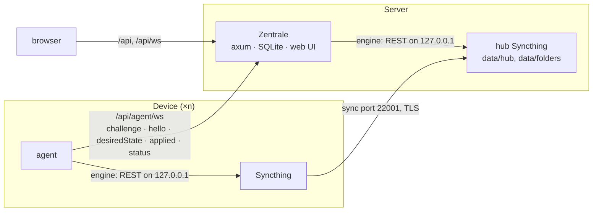
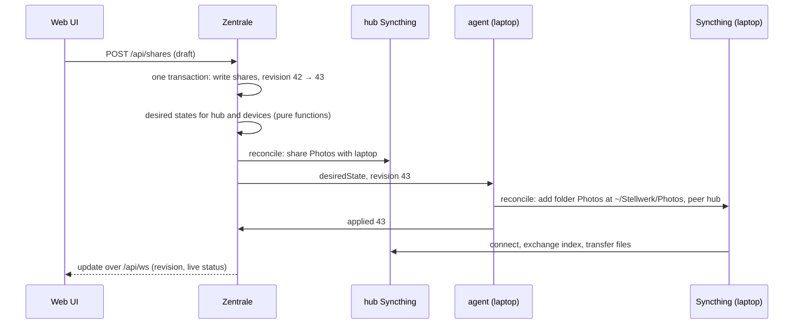

# Architecture

How Stellwerk is built: its parts, how they talk, how a change travels from a click to the
files on a device, and where the data lives. For using and running Stellwerk, start with the
[user guide](user-guide.md) and [installation](installation.md).

## Parts

- **Zentrale** (`crates/zentrale`): one Rust binary with login, SQLite, the desired state of
  every device with a revision number, the connections to all agents, and the web UI.
- **Hub Syncthing** on the server: steered by the Zentrale with the same code as the devices,
  member of every folder, keeps versions.
- **Agent** (`crates/agent`) on every device: starts its own Syncthing, brings its configuration
  to the desired state, reports status.
- **`protocol`**: the messages and the desired state. Describes devices, folders, modes and
  paths only.
- **`engine`**: the only crate that knows Syncthing.

The Zentrale never sends commands like "create folder X", always "this is how it should look,
revision 42". Applying is idempotent, so a device that was offline simply gets the current state.

## From a click to the files

What happens when you switch the cell *Photos × laptop* to **Both** and click **Apply**:

1. The UI sends the whole draft in one request. The Zentrale writes it and raises the revision
   in the same SQLite transaction, so a revision is always a complete configuration.
2. From the stored configuration it derives one desired state per device and one for the hub
   (`desired.rs`). Nothing is diffed against the previous revision.
3. The hub is reconciled directly; every connected agent gets its new desired state. An agent
   that is offline gets the newest one when it connects, whatever happened in between.
4. Each agent's reconciler compares its Syncthing's configuration with the desired state and
   makes only the API calls needed, then reports `applied` with the revision and any errors per
   folder. The overview shows **waiting** for devices that have not applied the current
   revision.
5. Syncthing on the device and on the hub do the rest: connect, exchange indexes, move files.
   The monitors on both sides report progress, which reaches the UI as live status.

## Protocol

The agent opens a WebSocket to the Zentrale (`/api/agent/ws`); messages are JSON with a `type`
field (`crates/protocol/src/messages.rs`).

| Direction | Message | Content |
|---|---|---|
| Zentrale → agent | `challenge` | a fresh nonce |
| agent → Zentrale | `hello` | public key, on first contact the one-time code; host name, OS, agent and Syncthing version, Syncthing device ID; a signature over the nonce and all these fields (`hello_payload`) |
| Zentrale → agent | `welcome` | the device's ID at the Zentrale |
| Zentrale → agent | `desiredState` | revision, peers (device IDs and addresses), folders with ID, label, mode, path, versioning, ignore patterns, peers |
| agent → Zentrale | `applied` | revision, errors per folder |
| agent → Zentrale | `status` | per folder: state, files and bytes in total and still needed, errors; on change, at most about once per second |
| Zentrale → agent | `waiting` | LAN pairing: the agent is unknown and came without a code; its key's fingerprint. The socket stays open until the UI decides |
| Zentrale → agent | `rejected` | why; the socket closes |

The desired state is always complete, never a diff: an agent that was offline for three days just
gets the current state when it connects.

## Pairing

1. "Pair device" in the UI: the Zentrale creates a one-time code (valid for 15 minutes) and
   stores only its hash.
2. On the device: `stellwerk-agent join --server https://… <code>` creates an Ed25519 key and
   stores server, key and code; `stellwerk-agent service install` starts the agent in the
   background.
3. The agent answers the Zentrale's challenge with a hello signed by its key and carrying the
   code. The Zentrale uses the code up and creates the device; the agent drops the code.
4. From then on the agent signs in with its key only. A blocked device is turned away.

**LAN pairing, without a code.** The Zentrale announces itself over mDNS as `_stellwerk._tcp`
(`crates/zentrale/src/discovery.rs`), with the TXT entry `url` when `--public-url` is set.
`stellwerk-agent join` without `--server` listens for four seconds and takes the one Zentrale
it finds (`crates/agent/src/discover.rs`); without a code it prints its key's fingerprint, the
first 8 bytes of the SHA-256 of the public key (`3F2A-91BC-04DE-77A1`). Its hello carries no
code, so the Zentrale answers `waiting` and lists it under **Devices → Waiting devices**
(`crates/zentrale/src/waiting.rs`). Approving creates the device and the connection goes on as
after a code; rejecting turns the key away until the Zentrale restarts. The list lives in
memory, holds at most 20 agents and forgets an agent that disconnects. `--lan-pairing false`
turns announcing and waiting off; agents without a code are then rejected.

The hub Syncthing listens on its own port (22001 by default, `--hub-listen`), so a Syncthing
already running on the server keeps 22000. Devices dial the hub at `--hub-address`; the hub
never needs to reach the devices.

## Zentrale

### Data model

SQLite with migrations embedded in the binary (`crates/zentrale/migrations`).

| Table | Columns |
|---|---|
| `devices` | id, name, kind, os, public_key, syncthing_id, agent_version, syncthing_version, approved, created_at, last_seen, applied_rev |
| `folders` | id, label, syncthing_folder_id, ignore_patterns, versioning, encrypted_on_hub, created_at |
| `shares` | folder_id, device_id, mode, path (no row = "off") |
| `enrollments` | code_hash, expires_at, used_at, device_id |
| `config_rev` | one revision number, raised in the same transaction as every change |
| `events` | at, device, folder, kind, text (activity feed) |
| `admin`, `sessions` | login |

### Login and API

One admin with a password (argon2id), set with `stellwerk set-password` on the server. A login
sets an HttpOnly, SameSite=Strict session cookie (Secure behind HTTPS) and returns a CSRF token
the UI sends back in `X-CSRF-Token` on every change. Only hashes of session tokens and pairing
codes are stored.

| Endpoint | Does |
|---|---|
| `GET /api/session`, `POST /api/login`, `POST /api/logout` | login state, log in, log out |
| `GET /api/overview` | revision, hub, devices (with online state), folders, shares |
| `POST /api/folders`, `PATCH`/`DELETE /api/folders/{id}` | create; rename or set ignore patterns; remove a folder |
| `POST /api/shares` | apply a draft of modes and paths as one revision |
| `PATCH`/`DELETE /api/devices/{id}` | rename, block, unblock, remove a device |
| `POST /api/enrollments`, `POST /api/enrollments/status` | new pairing code, has a device used it yet |
| `POST /api/waiting/{fingerprint}/approve`, `…/reject` | decide about a device waiting in the LAN |
| `GET /api/folders/{id}/conflicts/content`, `POST …/conflicts/resolve` | both sides of a conflict, resolve it |
| `GET /api/folders/{id}/versions`, `POST …/versions/restore` | versions on the hub, restore one |
| `GET /api/events` | activity feed |
| `GET /api/status` | live status of devices and hub |
| `GET /api/ws` | WebSocket with an `update` per change: revision, online devices, live status |

Every change raises the revision and sends connected agents and the hub their new desired state.

### Desired states

`crates/zentrale/src/desired.rs` turns the stored configuration into one desired state per
device and one for the hub, as pure functions. The topology is a star:

- a device has the hub as its only peer and shares each of its folders with the hub;
- the hub has every approved device as a peer and holds every folder under
  `<data>/folders/<syncthing folder id>`, in mode "both", with staggered versioning (one year by
  default), shared with every device that has the folder;
- a blocked device gets no desired state and disappears from the hub's peers and folders.

## Web UI

`web/`: React with TanStack Router (file-based routes), Query and Table, Tailwind 4 with design
tokens for light and dark, components in shadcn style on Radix, lucide icons. The release build
of the Zentrale embeds `web/dist`; paths outside `/api` fall back to `index.html`.

- **Overview**: devices online, folders, revision; the folder × device matrix. Clicks collect in
  a draft ("3 unsaved changes") and **Apply** sends it as one revision. The server column is
  fixed: the hub holds every folder. Cells of an offline device that has not applied the current
  revision show **waiting**.
- **Devices**: list with search and filter, rename, block, remove; waiting devices from the LAN;
  **Pair device** creates a code, shows the command per OS and waits until the device shows up,
  then asks for its folders.
- **Folders**: mode and local path per device; versions per file with restore; conflicts side by
  side; rename, ignore patterns (one per line, on every device and the hub), remove.
- **Conflicts**: every conflict of every folder in one list.

The [user guide](user-guide.md) describes each page in detail.

German and English with Paraglide: messages in `web/messages/{de,en}.json`, compiled to typed
functions; the language follows the browser and can be switched in the sidebar (kept in local
storage).

Live updates come through `/api/ws` (see above); polling every 30 seconds is only the fallback.
`src/api/types.ts` checks every answer with Zod.
`pnpm dev:demo` runs the UI on fixtures (`src/demo/`) without a Zentrale. The Playwright tests in
`e2e/` and the screenshots (`pnpm screenshots`, or **Actions → Update screenshots**) use the same
demo mode, so they need neither Rust nor Syncthing.

## Live status and activity

The engine's monitor (`crates/engine/src/monitor.rs`) long-polls Syncthing's `/rest/events` and
reads `/rest/db/status` for every folder whenever something happened, at most once per second.

- Each agent sends the result as `status` over its WebSocket.
- The Zentrale watches the hub the same way and also reads `/rest/db/completion` for every
  folder and device: how much of a folder a device has, known from its index even while it is
  offline ("214 changes wait on the server").
- Changes that arrive at the hub (`RemoteChangeDetected`, with the short ID of the device that
  made them) are counted per device and folder over 30 seconds and written to the activity feed
  ("laptop changed 18 files in Projekte"), as are pairings, connects and disconnects.
- The UI gets everything through `/api/ws`: one `update` with revision, online devices and the
  live state per change (throttled to 300 ms). The status goes straight into the query cache; a
  new revision or online state reloads the overview.

Syncthing keeps events for a mask only from its first request on (lib/api/api.go,
`getEventSub`), so the monitor starts together with Syncthing.

## Conflicts and versions

The hub holds every folder in full, so both are handled there and Syncthing carries the result
to every device (`crates/engine/src/files.rs`, `crates/zentrale/src/files.rs`).

- **Conflicts.** Syncthing names a conflict copy
  `name.sync-conflict-YYYYMMDD-HHMMSS-<short ID>.ext` (lib/model/folder_sendrecv.go). The
  Zentrale searches the hub's folders every 30 seconds, notes new conflicts in the activity feed
  and shows both sides, with a line diff for text up to 256 KB. Resolving happens on the hub's
  disk, followed by a rescan:
  - keep the current file: the copy goes to the versions;
  - keep the copy: the current file goes to the versions, the copy takes its name;
  - keep both: the copy becomes `name.<device>.ext` next to the original.

  The discarded side is moved into `.stversions` under Syncthing's own naming
  (`name~YYYYMMDD-HHMMSS.ext`, lib/versioner/util.go), so it shows up among the versions. The
  time in that name is UTC; Syncthing reads it as local time, which is the same in the Docker
  image.
- **Versions.** The hub keeps staggered versions (a year by default). The UI lists them through
  `GET /rest/folder/versions` and restores one with `POST /rest/folder/versions`, which archives
  the current file first.

## Agent

`stellwerk-agent run` loads `agent.json`, starts its Syncthing (downloading the pinned release on
first start), starts the monitor and connects to the Zentrale. It pings the Zentrale every 30
seconds and counts the connection as lost when nothing at all came back for 90 seconds, so a
link that died silently (suspend, NAT timeout) is noticed. A lost connection is retried after
1 second, doubling up to 30 seconds; after `rejected` it waits a minute. Syncthing keeps running
while the Zentrale is unreachable, so syncing with the hub goes on with the last applied state.

Its Syncthing listens on a random port on all interfaces, with discovery, relays and NAT
traversal off: the device dials the hub at the address from the desired state, and the hub,
which has no address for devices (`dynamic`), only accepts their connections.

**Service** (`crates/agent/src/service`): `service install` writes a definition for the binary
it runs from and its data directory and starts it. The definitions are pure functions with unit
tests (`definitions.rs`); `linux.rs`, `macos.rs` and `windows.rs` install them:

| System | Definition | Started with |
|---|---|---|
| Linux | systemd user unit, `Restart=on-failure` | `systemctl --user enable --now` |
| macOS | launchd agent with `RunAtLoad`, `KeepAlive` | `launchctl bootstrap gui/<uid>` |
| Windows | Task Scheduler task at logon, restart on failure, running `stellwerk-agent-background.exe` | `schtasks /Create /XML`, `/Run` |

Systemd and launchd stop the agent with `SIGTERM`, on which it shuts its Syncthing down cleanly.
A Windows task cannot be ended with a signal, so `service uninstall` writes a `stop` file into
the data directory, which the running agent looks for every second, and waits until the agent
has exited before removing the task. A stop file older than the agent's start is ignored, so a
leftover from an interrupted uninstall cannot stop a new agent.

## Engine

| Module | Does |
|---|---|
| `pin` | the pinned Syncthing version and the SHA-256 of each platform's release archive |
| `download` | fetches the archive once into a cache directory, checks it, unpacks binary and license |
| `process` | starts Syncthing with its own `--home`, GUI/API on 127.0.0.1 with a random port and a fresh API key; no auto-upgrade, no usage reporting |
| `client` | Syncthing REST API: `/rest/config`, `/rest/config/{devices,folders}/{id}`, `/rest/db/scan`, … |
| `reconcile` | pure function: actual config + desired state → list of API calls |
| `apply` | runs those calls; the only side effects of reconciling |
| `monitor` | event stream, folder status, completion of other devices, changes that arrived |
| `files` | conflict copies and versions in a folder on disk: find, parse, resolve, archive |

### Reconciler

1. Read `GET /rest/config` and the own device ID.
2. Compare with the desired state: add missing devices and folders, change differing ones,
   remove those no longer wanted. The own device is never removed.
3. Write the changes with `PUT`/`DELETE` on `/rest/config/devices/{id}` and
   `/rest/config/folders/{id}`, devices before the folders that name them; then the ignore
   patterns with `POST /rest/db/ignores?folder={id}` where they differ from `GET` (empty lines
   and trailing spaces do not count).

A folder with a new path is removed and added again, so Syncthing starts with a fresh index
instead of treating the files at the old path as deleted. The reconciler only changes
configuration; removing a folder leaves its files alone.

| Mode | Syncthing folder type |
|---|---|
| Both | `sendreceive` |
| Send only | `sendonly` |
| Receive only | `receiveonly` |
| Off | folder not present on the device |

## Roadmap

| Phase | Content | Gate |
|---|---|---|
| 0 · Spike ✅ | engine starts Syncthing, reconciler applies a fixed desired state | integration test "file from A arrives on B" is green |
| 1 · MVP ✅ | Zentrale with SQLite, agent over WebSocket, pairing with a one-time code, hub Syncthing, matrix and device list in the UI | 3-node test with an offline device green (`crates/zentrale/tests/phase1_gate.rs`), own devices one week in daily use (open) |
| 2 · Comfort ✅ | live status, activity, conflicts on the hub, versions, ignore patterns, German and English | E2E green, conflict and restore in the integration test (`crates/zentrale/tests/phase2_gate.rs`) |
| 3 · Distribution | Docker image and Quadlet ✅, LAN discovery ✅, agent as a service and Windows installer ✅, CI on Linux, Windows and macOS ✅; self-update with signature (open) | v1.0 published through `release.yml` |
