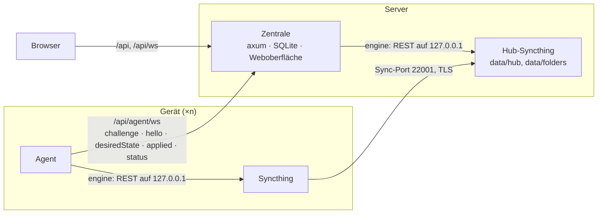
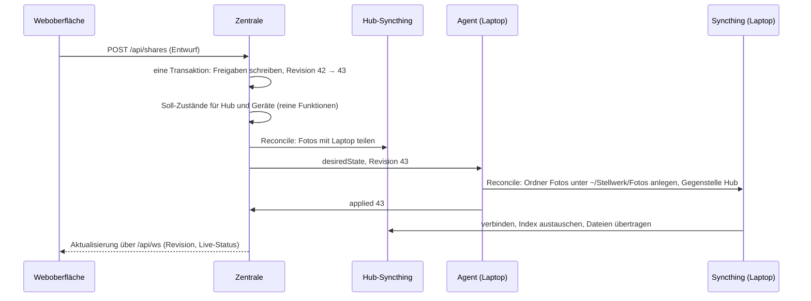

# Architektur

Wie Stellwerk gebaut ist: seine Teile, wie sie miteinander sprechen, wie eine Änderung von einem
Klick bis zu den Dateien auf einem Gerät gelangt und wo die Daten liegen. Für Bedienung und Betrieb
fang mit der [Bedienung](user-guide.md) und der [Installation](installation.md) an.

## Teile

- **Zentrale** (`crates/zentrale`): eine Rust-Programmdatei mit Anmeldung, SQLite, dem
  Soll-Zustand jedes Geräts mit einer Revisionsnummer, den Verbindungen zu allen Agenten und der
  Weboberfläche.
- **Hub-Syncthing** auf dem Server: von der Zentrale mit demselben Code gesteuert wie die Geräte,
  Mitglied in jedem Ordner, hält Versionen.
- **Agent** (`crates/agent`) auf jedem Gerät: startet sein eigenes Syncthing, bringt dessen
  Konfiguration auf den Soll-Zustand, meldet den Status.
- **`protocol`**: die Nachrichten und der Soll-Zustand. Beschreibt nur Geräte, Ordner, Modi und
  Pfade.
- **`engine`**: das einzige Crate, das Syncthing kennt.

Die Zentrale schickt nie Befehle wie „leg Ordner X an“, sondern immer „so soll es aussehen,
Revision 42“. Das Anwenden ist idempotent, ein Gerät, das offline war, bekommt also einfach den
aktuellen Stand.

## Vom Klick zu den Dateien

Was passiert, wenn du die Zelle *Fotos × Laptop* auf **Beides** stellst und auf **Anwenden**
klickst:

1. Die Oberfläche schickt den ganzen Entwurf in einer Anfrage. Die Zentrale schreibt ihn und
   erhöht die Revision in derselben SQLite-Transaktion, so ist eine Revision immer eine
   vollständige Konfiguration.
2. Aus der gespeicherten Konfiguration leitet sie einen Soll-Zustand pro Gerät und einen für den
   Hub ab (`desired.rs`). Nichts wird gegen die vorige Revision verglichen.
3. Der Hub wird direkt abgeglichen; jeder verbundene Agent bekommt seinen neuen Soll-Zustand. Ein
   Agent, der offline ist, bekommt beim Verbinden den neuesten, egal was dazwischen passiert ist.
4. Der Reconciler jedes Agenten vergleicht die Konfiguration seines Syncthing mit dem Soll-Zustand
   und macht nur die nötigen API-Aufrufe, dann meldet er `applied` mit der Revision und etwaigen
   Fehlern je Ordner. Die Übersicht zeigt **wartet** für Geräte, die die aktuelle Revision noch
   nicht angewendet haben.
5. Syncthing auf dem Gerät und auf dem Hub erledigen den Rest: verbinden, Indexe austauschen,
   Dateien übertragen. Die Monitore auf beiden Seiten melden den Fortschritt, der als Live-Status
   in der Oberfläche ankommt.

## Protokoll

Der Agent öffnet einen WebSocket zur Zentrale (`/api/agent/ws`); die Nachrichten sind JSON mit
einem Feld `type` (`crates/protocol/src/messages.rs`).

| Richtung | Nachricht | Inhalt |
|---|---|---|
| Zentrale → Agent | `challenge` | eine neue Nonce |
| Agent → Zentrale | `hello` | öffentlicher Schlüssel, beim ersten Kontakt der Einmal-Code; Hostname, Betriebssystem, Version von Agent und Syncthing, Syncthing-Geräte-ID; eine Signatur über die Nonce und all diese Felder (`hello_payload`) |
| Zentrale → Agent | `welcome` | die ID des Geräts in der Zentrale |
| Zentrale → Agent | `desiredState` | Revision, Gegenstellen (Geräte-IDs und Adressen), Ordner mit ID, Bezeichnung, Modus, Pfad, Versionierung, Ignoriermustern, Gegenstellen |
| Agent → Zentrale | `applied` | Revision, Fehler je Ordner |
| Agent → Zentrale | `status` | je Ordner: Zustand, Dateien und Bytes insgesamt und noch benötigt, Fehler; bei Änderung, höchstens etwa einmal pro Sekunde |
| Zentrale → Agent | `waiting` | Koppeln im LAN: Der Agent ist unbekannt und kam ohne Code; der Fingerabdruck seines Schlüssels. Der Socket bleibt offen, bis die Oberfläche entscheidet |
| Zentrale → Agent | `browse` | die Ordnerauswahl: eine Anfrage-ID und ein Pfad (leer für das Home-Verzeichnis) |
| Agent → Zentrale | `listing` | die Antwort unter derselben ID: das Verzeichnis, sein übergeordnetes Verzeichnis, seine Unterverzeichnisse mit Name und Pfad, das Home-Verzeichnis und die Wurzeln der Dateisysteme; oder warum es sich nicht lesen ließ |
| Zentrale → Agent | `search` | eine Anfrage-ID, ein Startpfad (leer für das Home-Verzeichnis) und ein gesuchter Name |
| Agent → Zentrale | `matches` | die Antwort unter derselben ID: das Startverzeichnis, die Verzeichnisse, deren Name jedes Wort der Suche enthält (flachere zuerst, nichts unterhalb eines Treffers), und ob die Suche früher aufgehört hat; oder warum sie nicht starten konnte |
| Zentrale → Agent | `rejected` | warum; der Socket schließt |

Der Soll-Zustand ist immer vollständig, nie ein Diff: Ein Agent, der drei Tage offline war,
bekommt beim Verbinden einfach den aktuellen Stand.

Die Zentrale schickt jedem verbundenen Agenten alle 30 Sekunden einen WebSocket-Ping, auch während
er auf Freigabe wartet, und beendet die Sitzung, wenn 90 Sekunden lang nichts (nicht einmal ein
Pong) angekommen ist, so hält eine still abgerissene Verbindung (Standby, NAT-Timeout) ein Gerät
nicht „online“. Die WebSocket-Bibliothek des Agenten beantwortet Pings von selbst.

## Koppeln

1. „Gerät koppeln“ in der Oberfläche: Die Zentrale erzeugt einen Einmal-Code (15 Minuten gültig)
   und speichert nur seinen Hash.
2. Auf dem Gerät: Der Befehl aus dem Dialog holt das Installationsskript der Version der Zentrale
   aus dem GitHub-Release (`installer/install.sh`, `install.ps1`), das den Agenten dieses Releases
   herunterlädt und `stellwerk-agent join --server https://… <code>` ausführt. Das erzeugt einen
   Ed25519-Schlüssel und speichert Server, Schlüssel und Code; `stellwerk-agent service install`
   startet den Agenten im Hintergrund. Hinter einer eigenen CA enthält der Befehl auch den
   Fingerabdruck der CA (`--ca-sha256`): `join` holt die CA von `/ca.crt` der Zentrale, behält sie
   nur, wenn der Fingerabdruck stimmt, und vertraut ihr von da an für die Verbindung, so wie ein
   Join-Token von k3s die CA seines Servers festlegt.
3. Der Agent beantwortet die Challenge der Zentrale mit einem Hello, das mit seinem Schlüssel
   signiert ist und den Code enthält. Die Zentrale verbraucht den Code und legt das Gerät an; der
   Agent verwirft den Code.
4. Von da an meldet sich der Agent nur mit seinem Schlüssel an. Ein gesperrtes Gerät wird
   abgewiesen. Ein erneutes `join` mit einem neuen Code behält den Schlüssel: Die Zentrale erkennt
   das Gerät, lässt es als sich selbst herein und markiert den Code als benutzt, so geht der
   Dialog zum Koppeln weiter.

**Koppeln im LAN, ohne Code.** Die Zentrale kündigt sich über mDNS als `_stellwerk._tcp` an
(`crates/zentrale/src/discovery.rs`), mit dem TXT-Eintrag `url`, wenn `--public-url` gesetzt ist.
`stellwerk-agent join` ohne `--server` lauscht vier Sekunden und nimmt die eine Zentrale, die es
findet (`crates/agent/src/discover.rs`); ohne Code zeigt es den Fingerabdruck seines Schlüssels,
die ersten 8 Bytes des SHA-256 des öffentlichen Schlüssels (`3F2A-91BC-04DE-77A1`). Sein Hello
enthält keinen Code, also antwortet die Zentrale mit `waiting` und listet es unter **Geräte →
Wartende Geräte** (`crates/zentrale/src/waiting.rs`). Freigeben legt das Gerät an, und die
Verbindung geht weiter wie nach einem Code; Ablehnen weist den Schlüssel ab, bis die Zentrale neu
startet. Die Liste lebt im Speicher, hält höchstens 20 Agenten und vergisst einen Agenten, der die
Verbindung trennt. `--lan-pairing false` schaltet Ankündigen und Warten aus; Agenten ohne Code
werden dann abgewiesen.

Das Hub-Syncthing lauscht auf einem eigenen Port (standardmäßig 22001, `--hub-listen`), so behält
ein Syncthing, das schon auf dem Server läuft, die 22000. Die Geräte wählen den Hub unter
`--hub-address` an; der Hub muss die Geräte nie erreichen.

## Zentrale

### Datenmodell

SQLite mit Migrationen, die in die Programmdatei eingebettet sind (`crates/zentrale/migrations`).

| Tabelle | Spalten |
|---|---|
| `devices` | id, name, kind, os, public_key, syncthing_id, agent_version, syncthing_version, approved, created_at, last_seen, applied_rev |
| `folders` | id, label, syncthing_folder_id, ignore_patterns, versioning, encrypted_on_hub, created_at |
| `shares` | folder_id, device_id, mode, path (keine Zeile = „aus“) |
| `enrollments` | code_hash, expires_at, used_at, device_id |
| `config_rev` | eine Revisionsnummer, erhöht in derselben Transaktion wie jede Änderung |
| `events` | at, device, folder, kind, text (Aktivitätsverlauf) |
| `admin`, `sessions` | Anmeldung |
| `api_tokens` | id, name, scope, token_hash, created_at, last_used_at |

### Anmeldung und API { #login-and-api }

Ein Admin mit einem Passwort (argon2id), gesetzt mit `stellwerk set-password` auf dem Server. Eine
Anmeldung setzt ein Sitzungs-Cookie mit HttpOnly und SameSite=Strict (Secure hinter HTTPS) und
gibt ein CSRF-Token zurück, das die Oberfläche bei jeder Änderung in `X-CSRF-Token` zurückschickt.
Gespeichert werden nur Hashes der Sitzungstokens und der Codes zum Koppeln.

Skripte und KI-Assistenten benutzen stattdessen ein API-Token (`Authorization: Bearer stw_…`,
kein CSRF-Token; `crates/zentrale/src/api/access.rs`). Sein Umfang entscheidet, was es aufrufen
darf: **Lesen** die unten mit R markierten Endpunkte, **Verwalten** auch die mit M markierten.
Alles andere braucht die Anmeldung im Browser, und eine Anfrage mit einem Token bekommt dort
`403`. Ein neues Passwort widerruft jedes Token.

| Endpunkt | Tut | Token |
|---|---|---|
| `GET /api/session`, `POST /api/login`, `POST /api/logout` | Anmeldestatus, anmelden, abmelden | |
| `GET /api/overview` | Revision, Hub, Geräte (mit Online-Zustand), Ordner, Freigaben | R |
| `POST /api/folders`, `PATCH /api/folders/{id}` | anlegen; umbenennen oder Ignoriermuster setzen | M |
| `DELETE /api/folders/{id}` | einen Ordner entfernen | |
| `POST /api/shares` | einen Entwurf aus Modi und Pfaden als eine Revision anwenden | M |
| `PATCH`/`DELETE /api/devices/{id}` | ein Gerät umbenennen, sperren, entsperren, entfernen | |
| `GET /api/devices/{id}/browse?path=` | die Ordnerauswahl: ein Verzeichnis auf einem Gerät, das online ist, erfragt bei seinem Agenten (409 offline, 504 keine Antwort) | R |
| `GET /api/devices/{id}/search?q=&path=` | Verzeichnisse auf einem Gerät, das online ist, deren Name zu `q` passt, unterhalb von `path` (leer: das Home-Verzeichnis); erfragt bei seinem Agenten wie `browse` | R |
| `POST /api/enrollments`, `POST /api/enrollments/status` | neuer Code zum Koppeln, hat ein Gerät ihn schon benutzt | |
| `POST /api/waiting/{fingerprint}/approve`, `…/reject` | über ein Gerät entscheiden, das im LAN wartet | |
| `GET /api/folders/{id}/conflicts/content`, `POST …/conflicts/resolve` | beide Seiten eines Konflikts, ihn lösen | |
| `GET /api/folders/{id}/versions`, `POST …/versions/restore` | Versionen auf dem Hub, eine wiederherstellen | |
| `GET /api/events` | Aktivitätsverlauf | R |
| `GET /api/status` | Live-Status von Geräten und Hub | R |
| `GET /api/ws` | WebSocket mit einem `update` je Änderung: Revision, Geräte online, Live-Status | |
| `GET`/`POST /api/tokens`, `DELETE /api/tokens/{id}` | API-Tokens auflisten, erstellen (das Token steht dieses eine Mal in der Antwort), widerrufen | |
| `POST /mcp` | der MCP-Server (siehe unten) | R/M |

Jede Änderung erhöht die Revision und schickt den verbundenen Agenten und dem Hub ihren neuen
Soll-Zustand. Ein fehlgeschlagener Abgleich des Hubs (Hub-API kurz nicht erreichbar, ein
abgelehnter Aufruf) wird nach 1 Sekunde erneut versucht, verdoppelt bis zu einer Minute, bis er
klappt oder eine neue Revision kommt.

### Soll-Zustände

`crates/zentrale/src/desired.rs` macht aus der gespeicherten Konfiguration einen Soll-Zustand pro
Gerät und einen für den Hub, als reine Funktionen. Die Topologie ist ein Stern:

- Ein Gerät hat den Hub als einzige Gegenstelle und teilt jeden seiner Ordner mit dem Hub;
- der Hub hat jedes freigegebene Gerät als Gegenstelle und hält jeden Ordner unter
  `<data>/folders/<Syncthing-Ordner-ID>`, im Modus „Beides“, mit gestaffelter Versionierung
  (standardmäßig ein Jahr), geteilt mit jedem Gerät, das den Ordner hat;
- ein gesperrtes Gerät bekommt keinen Soll-Zustand und verschwindet aus den Gegenstellen und
  Ordnern des Hubs;
- eine Syncthing-Geräte-ID ist eine Gegenstelle, auch wenn zwei Geräte sie melden; der Speicher
  weist ein Gerät ab, dessen Syncthing-ID schon einem anderen gehört.

## MCP-Server

`crates/zentrale/src/mcp`: Die Zentrale beantwortet das [Model Context
Protocol](https://modelcontextprotocol.io/specification) unter `POST /mcp`, so können Assistenten
wie Claude Code sie steuern. Streamable HTTP in seiner einfachsten Form: Jeder POST trägt eine
JSON-RPC-Nachricht und bekommt eine JSON-Antwort (`202` für eine Notification); es gibt keine
Sitzungen und keine Server-Sent Events, also sind `GET` und `DELETE` `405`. Er spricht die
Protokollversionen 2025-11-25 bis zurück zu 2024-11-05 und beantwortet `initialize`, `ping`,
`tools/list` und `tools/call`.

Herein kommen nur API-Tokens (sonst `401` mit `WWW-Authenticate: Bearer`); `tools/list` zeigt
einem Token die Werkzeuge seines Umfangs. Eine Anfrage mit einem `Origin` eines anderen Hosts wird
abgelehnt.

| Modul | Tut |
|---|---|
| `rpc` | JSON-RPC-Nachrichten, Fehler, Aushandeln der Version, die Antwort auf `initialize` |
| `tools` | die sieben Werkzeuge mit ihren Annotationen (`readOnlyHint`, `destructiveHint`) und was jedes in der Zentrale aufruft |
| `schemas` | die JSON-Schemas der Argumente der Werkzeuge |
| `views` | reine Funktionen: Geräte und Ordner nach ID oder Name, und ein Entwurf, geprüft gegen die Konfiguration, mit den Pfaden, die er bekommt (der Standard des Speichers für eine neue Freigabe), und einer Beschreibung mit der Größe des Ordners |

`preview_shares` und `apply_shares` nehmen denselben Entwurf: Zellen aus Ordner, Gerät, Modus
(`sendReceive`, `sendOnly`, `receiveOnly`, `off`) und einem optionalen Pfad. Die Vorschau führt
dieselbe Prüfung aus und ändert nichts; Anwenden schreibt die Zellen, die sich ändern, in einer
Revision über dieselbe Funktion des Speichers wie `POST /api/shares`. Die Anweisungen, die bei
`initialize` mitgehen, sagen dem Assistenten die Reihenfolge: finden, anlegen, Vorschau, fragen,
anwenden.

## Weboberfläche

`web/`: React mit TanStack Router (dateibasierte Routen), Query und Table, Tailwind 4 mit Design
Tokens für hell und dunkel, Komponenten im shadcn-Stil auf Radix, Icons von lucide. Der Build
tauscht die React-Runtime gegen [TanStack Redact](https://github.com/TanStack/redact) (ein
Vite-Plugin; der Code importiert weiter aus `react`), das synchron rendert und das anfängliche
JavaScript um etwa ein Drittel kleiner macht; Vitest bleibt bei React, die E2E-Tests laufen gegen
den Build mit Redact. Der Release-Build der Zentrale bettet `web/dist` ein; Pfade außerhalb von
`/api` fallen auf `index.html` zurück.

- **Übersicht**: Geräte online, Ordner, Revision; die Matrix aus Ordnern × Geräten. Klicks sammeln
  sich in einem Entwurf („3 ungespeicherte Änderungen.“), und **Anwenden** schickt ihn als eine
  Revision. Die Spalte des Servers ist fest: Der Hub hält jeden Ordner. Zellen eines Geräts, das
  offline ist und die aktuelle Revision noch nicht angewendet hat, zeigen **wartet**.
- **Geräte**: Liste mit Suche und Filter, umbenennen, sperren, entfernen; wartende Geräte aus dem
  LAN; **Gerät koppeln** erzeugt einen Code, zeigt den Befehl je Betriebssystem und wartet, bis das
  Gerät auftaucht, dann fragt es nach seinen Ordnern.
- **Ordner**: Modus und lokaler Pfad je Gerät; Versionen je Datei mit Wiederherstellen; Konflikte
  nebeneinander; umbenennen, Ignoriermuster (eines pro Zeile, auf jedem Gerät und dem Hub),
  entfernen.
- **Konflikte**: jeder Konflikt jedes Ordners in einer Liste.
- **API-Tokens**: ein Token für ein Skript oder einen Assistenten erstellen (einmal gezeigt, mit
  dem Befehl, der den MCP-Server zu Claude Code hinzufügt), sehen, wann jedes zuletzt benutzt
  wurde, es widerrufen.

Die [Bedienung](user-guide.md) beschreibt jede Seite im Detail.

Deutsch und Englisch mit Paraglide: Texte in `web/messages/{de,en}.json`, kompiliert zu typisierten
Funktionen; die Sprache folgt dem Browser und lässt sich in der Seitenleiste umschalten (gemerkt im
Local Storage).

Hell und dunkel: Die Farb-Tokens in `src/styles.css` sind `light-dark()`-Paare, so wählt sie das
`color-scheme` des Browsers. Der Schalter für die Darstellung in der Seitenleiste
(`src/lib/theme.ts`) legt sie mit `data-theme="light"` oder `"dark"` auf `<html>` fest und merkt
sich die Wahl im Local Storage; ohne ihn entscheidet das System. Die Variante `dark:` von Tailwind
folgt derselben Wahl. `/api/overview` liefert die `version` der Zentrale für die Seitenleiste.

Die Live-Aktualisierung kommt über `/api/ws` (siehe oben); Abfragen alle 30 Sekunden sind nur der
Rückfall. `src/api/types.ts` prüft jede Antwort mit Zod. `bun run dev:demo` startet die Oberfläche
mit Fixtures (`src/demo/`) ohne Zentrale. Die Playwright-Tests in `e2e/` und die Screenshots
(`bun run screenshots` oder **Actions → Update screenshots**) nutzen denselben Demomodus, sie
brauchen also weder Rust noch Syncthing.

## Live-Status und Aktivität

Der Monitor der Engine (`crates/engine/src/monitor.rs`) fragt `/rest/events` von Syncthing per Long
Polling ab und liest `/rest/db/status` für jeden Ordner, sobald etwas passiert ist, höchstens
einmal pro Sekunde.

- Jeder Agent schickt das Ergebnis als `status` über seinen WebSocket.
- Die Zentrale beobachtet den Hub genauso und liest außerdem `/rest/db/completion` für jeden
  Ordner und jedes Gerät: wie viel von einem Ordner ein Gerät hat, bekannt aus seinem Index, auch
  während es offline ist („214 Änderungen warten auf dem Server“). Elemente, die in einem Ordner
  mit Nur empfangen lokal geändert wurden, zählen dort auch als fehlend, weil Syncthing sie als
  ungültig mit leerer Version ankündigt. Nur das Gerät selbst kann sie unterscheiden, deshalb
  enthält sein `status` auch `need_items` und `local_changes`, und die Oberfläche zeigt „Synchron,
  1.903 lokale Änderungen“ statt „Lädt“. Ältere Agenten lassen beides weg; die Oberfläche behält
  dann die Zahlen des Hubs.
- Änderungen, die am Hub ankommen (`RemoteChangeDetected`, mit der kurzen ID des Geräts, das sie
  gemacht hat), werden je Gerät und Ordner über 30 Sekunden gezählt und in den Aktivitätsverlauf
  geschrieben („Laptop hat 18 Dateien in Projekte geändert“), ebenso Kopplungen, Verbindungen und
  Trennungen.
- Die Oberfläche bekommt alles über `/api/ws`: ein `update` mit Revision, Geräten online und dem
  Live-Zustand je Änderung (gedrosselt auf 300 ms). Der Status geht direkt in den Query-Cache;
  eine neue Revision oder ein neuer Online-Zustand lädt die Übersicht neu.

Syncthing hält Events für eine Maske erst ab ihrer ersten Anfrage (lib/api/api.go,
`getEventSub`), deshalb startet der Monitor zusammen mit Syncthing.

## Konflikte und Versionen

Der Hub hält jeden Ordner vollständig, also werden beide dort behandelt, und Syncthing trägt das
Ergebnis zu jedem Gerät (`crates/engine/src/files.rs`, `crates/zentrale/src/files.rs`).

- **Konflikte.** Syncthing benennt eine Konfliktkopie
  `name.sync-conflict-YYYYMMDD-HHMMSS-<short ID>.ext` (lib/model/folder_sendrecv.go). Die
  Zentrale durchsucht die Ordner des Hubs alle 30 Sekunden, vermerkt neue Konflikte im
  Aktivitätsverlauf und zeigt beide Seiten, mit einem zeilenweisen Diff für Text bis 256 KB. Die
  temporären Dateien von Syncthing sind keine Konflikte, und symbolische Links werden weder
  gelistet noch gelesen, da ein Gerät einen abgleichen könnte, der irgendwohin auf dem Server
  zeigt. Gelöst wird auf der Platte des Hubs, gefolgt von einem Rescan:
  - die aktuelle Datei behalten: Die Kopie kommt in die Versionen;
  - die Kopie behalten: Die aktuelle Datei kommt in die Versionen, die Kopie bekommt ihren Namen;
  - beide behalten: Die Kopie wird zu `name.<gerät>.ext` neben dem Original.

  Die verworfene Seite wird mit der eigenen Benennung von Syncthing nach `.stversions`
  verschoben (`name~YYYYMMDD-HHMMSS.ext`, lib/versioner/util.go), so erscheint sie unter den
  Versionen.

  Beide Namen tragen eine Zeit ohne Zone. Syncthing schreibt und liest sie als Ortszeit
  (`conflictName`; `ParseInLocation(…, time.Local)` in lib/versioner/util.go), Stellwerk als UTC.
  Im Docker-Image ist beides UTC; auf einem Server in einer anderen Zeitzone weichen die
  angezeigte Zeit des Konflikts und die Zeit einer beim Lösen archivierten Version um den Versatz
  der Zone ab, und das gestaffelte Aufräumen altert eine solche Version um genau so viel.
- **Versionen.** Der Hub hält gestaffelte Versionen (standardmäßig ein Jahr). Die Oberfläche listet
  sie über `GET /rest/folder/versions` und stellt eine mit `POST /rest/folder/versions` wieder
  her, das die aktuelle Datei vorher archiviert.

## Agent

`stellwerk-agent run` lädt `agent.json`, startet sein Syncthing (beim ersten Start lädt es das
festgelegte Release herunter), startet den Monitor und verbindet sich mit der Zentrale. Er pingt
die Zentrale alle 30 Sekunden und betrachtet die Verbindung als verloren, wenn 90 Sekunden lang gar
nichts zurückkam, so fällt eine still abgerissene Verbindung (Standby, NAT-Timeout) auf. Eine
verlorene Verbindung wird nach 1 Sekunde erneut versucht, verdoppelt bis 30 Sekunden; nach
`rejected` wartet er eine Minute. Syncthing läuft weiter, während die Zentrale nicht erreichbar
ist, so geht der Abgleich mit dem Hub mit dem zuletzt angewendeten Stand weiter. Syncthing läuft
mit `--no-restart`: Beendet es sich (ein Absturz oder ein Neustart, der über seine API angefordert
wurde), beendet sich der Agent mit einem Fehler, und der Dienstmanager startet beide neu. Die
Zentrale macht es mit dem Hub-Syncthing genauso und überlässt den Neustart Docker oder systemd.

Bevor er einen Soll-Zustand anwendet, fügt der Agent die Ausnahmen hinzu, die andere Programme auf
dem Gerät in `ignore.d/` aufgelistet haben (`crates/agent/src/local_ignores.rs`, ein Merge mit
Unit-Tests, dem die Funktion übergeben wird, die Links auflöst): Jeder gelistete Pfad in einem
Ordner wird zu einem verankerten, maskierten Muster für genau diesen Pfad, platziert vor jeder
Zeile, die die Datei behalten könnte (`engine::ignore::anchored_pattern`, geprüft gegen das
festgelegte Syncthing in `crates/engine/tests/anchored_ignores.rs`). Die Listen werden alle
10 Sekunden neu gelesen; eine geänderte Liste wird sofort auf den letzten Soll-Zustand angewendet.

**Verzeichnisse auf Anfrage** (`crates/agent/src/browse.rs`, `search.rs`): `browse` listet die
Unterverzeichnisse eines Verzeichnisses für die Ordnerauswahl auf; `search` geht von einem
Startverzeichnis aus in die Breite und liefert die Verzeichnisse, deren Name jedes Wort der Suche
als Wortanfang enthält, in dieser Reihenfolge („game of thrones“ findet `Game.of.Thrones.S01`),
ohne unterhalb eines Treffers zu suchen. Sie überspringt versteckte Verzeichnisse, folgt keinen
symbolischen Links und hört nach 8 Ebenen, 50 Treffern oder 10 Sekunden auf und sagt das
(`truncated`). Beide laufen außerhalb der Async-Runtime und nebeneinander, so hält eine Suche weder
die Ordnerauswahl noch einen neuen Soll-Zustand auf; ein Agent, der eine Anfrage nicht kennt, lässt
sie unbeantwortet, und die Zentrale meldet nach ihrem Timeout, dass das Gerät nicht geantwortet hat
und sein Agent aktualisiert werden sollte.

Sein Syncthing lauscht auf einem zufälligen Port auf allen Schnittstellen, mit Discovery, Relays
und NAT-Traversal aus: Das Gerät wählt den Hub unter der Adresse aus dem Soll-Zustand an, und der
Hub, der keine Adresse für Geräte hat (`dynamic`), nimmt nur ihre Verbindungen an.

**Dienst** (`crates/agent/src/service`): `service install` schreibt eine Definition für die
Programmdatei, aus der es läuft, und für ihr Datenverzeichnis und startet sie, oder startet einen
Agenten neu, der schon läuft, so übernimmt eine ersetzte Programmdatei. Die Definitionen sind
reine Funktionen mit Unit-Tests (`definitions.rs`); `linux.rs`, `macos.rs` und `windows.rs`
installieren sie:

| System | Definition | Gestartet mit |
|---|---|---|
| Linux | systemd-Benutzer-Unit, `Restart=on-failure` | `systemctl --user enable`, `restart` |
| macOS | launchd-Agent mit `RunAtLoad`, `KeepAlive` | `launchctl bootout`, `bootstrap gui/<uid>` |
| Windows | Aufgabe in der Aufgabenplanung bei der Anmeldung, Neustart bei Fehler, startet `stellwerk-agent-background.exe` | Stop-Datei (unten), `schtasks /Create /XML`, `/Run` |

systemd und launchd stoppen den Agenten mit `SIGTERM`, worauf er sein Syncthing sauber
herunterfährt. Eine Windows-Aufgabe lässt sich nicht mit einem Signal beenden, deshalb schreiben
`service uninstall`, und `service install`, wenn ein Agent läuft, eine Datei `stop` in das
Datenverzeichnis, nach der der laufende Agent jede Sekunde schaut, und warten, bis sich der Agent
beendet hat, bevor sie die Aufgabe entfernen oder ersetzen. Eine Stop-Datei, die älter ist als der
Start des Agenten, wird ignoriert, so kann ein Rest aus einer unterbrochenen Deinstallation keinen
neuen Agenten stoppen.

## Engine

| Modul | Tut |
|---|---|
| `pin` | die festgelegte Syncthing-Version und der SHA-256 des Release-Archivs jeder Plattform |
| `download` | holt das Archiv einmal in ein Cache-Verzeichnis, prüft es, entpackt Programmdatei und Lizenz |
| `process` | startet Syncthing mit eigenem `--home`, GUI/API auf 127.0.0.1 mit zufälligem Port und neuem API-Schlüssel; kein Auto-Upgrade, keine Nutzungsstatistik |
| `client` | REST-API von Syncthing: `/rest/config`, `/rest/config/{devices,folders}/{id}`, `/rest/db/scan`, … |
| `reconcile` | reine Funktion: Ist-Konfiguration + Soll-Zustand → Liste von API-Aufrufen |
| `apply` | führt diese Aufrufe aus; die einzigen Seiteneffekte des Abgleichs |
| `monitor` | Event-Strom, Ordnerstatus, Vollständigkeit anderer Geräte, angekommene Änderungen |
| `files` | Konfliktkopien und Versionen in einem Ordner auf der Platte: finden, parsen, lösen, archivieren |

### Reconciler

1. `GET /rest/config` und die eigene Geräte-ID lesen.
2. Mit dem Soll-Zustand vergleichen: fehlende Geräte und Ordner hinzufügen, abweichende ändern,
   nicht mehr gewollte entfernen. Das eigene Gerät wird nie entfernt.
3. Die Änderungen mit `PUT`/`DELETE` auf `/rest/config/devices/{id}` und
   `/rest/config/folders/{id}` schreiben, Geräte vor den Ordnern, die sie nennen; dann die
   Ignoriermuster mit `POST /rest/db/ignores?folder={id}`, wo sie von `GET` abweichen (leere Zeilen
   und Leerzeichen drumherum zählen nicht, da Syncthing sie auch trimmt). Ein neuer Ordner bekommt
   seine Muster immer geschrieben, auch keine, so bleibt eine `.stignore`, die in seinem
   Verzeichnis liegt, nicht in Kraft.

Ein Ordner mit neuem Pfad wird entfernt und neu hinzugefügt, so beginnt Syncthing mit einem
frischen Index, statt die Dateien am alten Pfad als gelöscht zu behandeln. Der Reconciler ändert
nur Konfiguration; einen Ordner zu entfernen lässt seine Dateien in Ruhe.

| Modus | Syncthing-Ordnertyp |
|---|---|
| Beides | `sendreceive` |
| Nur senden | `sendonly` |
| Nur empfangen | `receiveonly` |
| Aus | Ordner nicht auf dem Gerät vorhanden |

## Roadmap { #roadmap }

| Phase | Inhalt | Meilenstein |
|---|---|---|
| 0 · Spike ✅ | Engine startet Syncthing, Reconciler wendet einen festen Soll-Zustand an | Integrationstest „Datei von A kommt auf B an“ ist grün |
| 1 · MVP ✅ | Zentrale mit SQLite, Agent über WebSocket, Koppeln mit Einmal-Code, Hub-Syncthing, Matrix und Geräteliste in der Oberfläche | Test mit 3 Knoten und einem Gerät, das offline ist, grün (`crates/zentrale/tests/phase1_gate.rs`), eigene Geräte eine Woche im Alltag (offen) |
| 2 · Komfort ✅ | Live-Status, Aktivität, Konflikte auf dem Hub, Versionen, Ignoriermuster, Deutsch und Englisch | E2E grün, Konflikt und Wiederherstellen im Integrationstest (`crates/zentrale/tests/phase2_gate.rs`) |
| 3 · Verteilung | Docker-Image und Quadlet ✅, Erkennung im LAN ✅, Agent als Dienst und Windows-Installer ✅, CI unter Linux, Windows und macOS ✅; Selbst-Update des Agenten unter Linux und macOS ✅, unter Windows (offen) | v1.0 veröffentlicht über `release.yml` |
