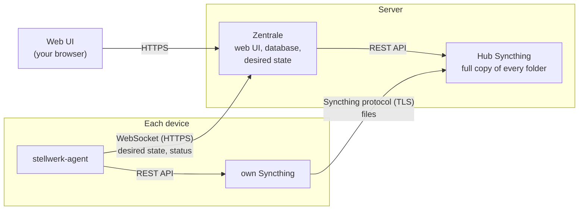

# Stellwerk

**Central web UI to manage Syncthing on all your devices.** Pair a device once, then decide in
one place which folders it gets, in which direction and at which path. Every device is set up
automatically; nobody clicks "accept" on each PC.

## How it works in one minute

- The **Zentrale** runs on your server. It stores which folder goes to which device and turns
  that into a *desired state* for every device.
- A small **agent** runs on every device (Linux, Windows, macOS). It brings its own Syncthing,
  receives its desired state from the Zentrale and configures its Syncthing to match it.
- A **hub Syncthing** on the server is a member of every folder and keeps a full copy with
  versions. Devices sync with the hub, so two PCs that are never on at the same time still get
  each other's changes.
- **Syncthing moves the files**, encrypted and directly between device and server. Stellwerk only
  steers Syncthing; it never touches your files except when you resolve a conflict or restore a
  version.

## Where to go next

| If you want to … | Read |
|---|---|
| try it and sync a first folder | [Getting started](getting-started.md) |
| know what each part of the UI does | [User guide](user-guide.md) |
| run the server for real: container, reverse proxy, backups, updates | [Installation](installation.md) |
| look up an option, a port or a file | [Reference](reference.md) |
| know who can access what | [Security](security.md) |
| fix something that does not work | [Troubleshooting](troubleshooting.md) |
| understand the design: protocol, reconciler, data model | [Architecture](architecture.md) |
| build, test or change Stellwerk | [Development](development.md) |

## Status

Stellwerk is before v1.0. The Zentrale, the agent with its service and the Windows installer,
pairing with a code or in the LAN, the matrix, live status, conflicts, versions and ignore
patterns work and are tested against real Syncthing instances on Linux, Windows and macOS. Open
before v1.0: self-update of the agent with a signature, and the first published release. See the
[roadmap](architecture.md#roadmap).
