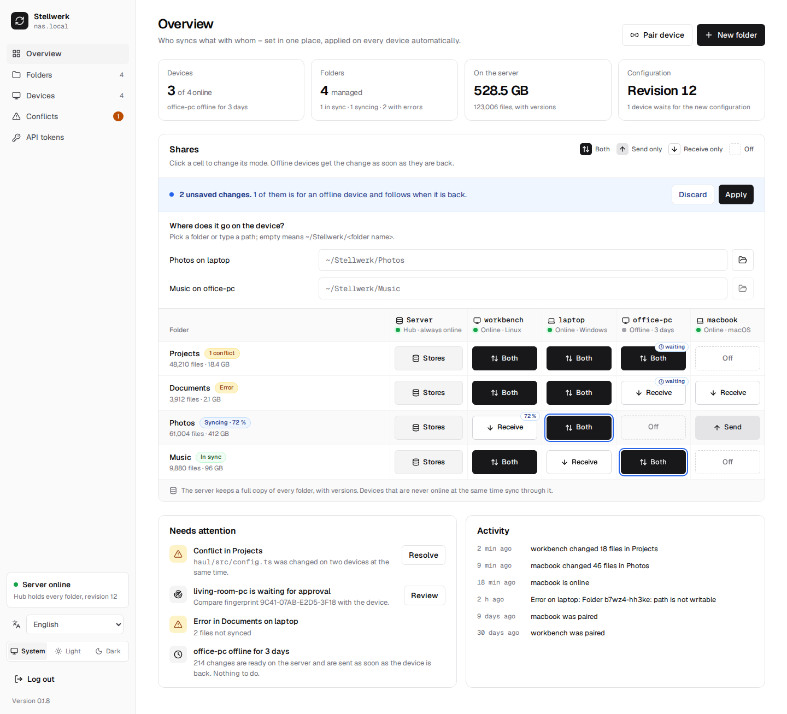
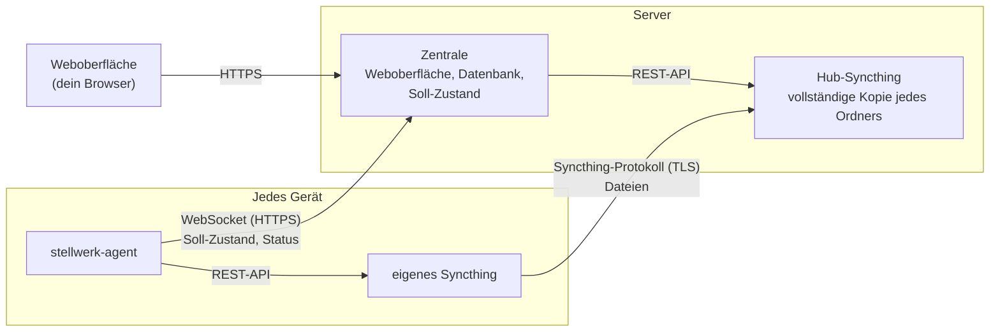

# Stellwerk

**Dateien auf allen Rechnern im Betrieb aktuell halten, ohne Cloud und ohne Fileserver.**
Projektordner, Vorlagen und Pläne kommen auf den Büro-PC, den Laptop des Chefs und das Notebook an
der Baustelle; ein ausgeschalteter PC holt auf, sobald er wieder an ist.

Stellwerk ist eine zentrale Weboberfläche für Syncthing auf deinem eigenen Server. Du koppelst ein
Gerät einmal und legst dann an einer Stelle fest, welche Ordner es bekommt, in welche Richtung und
unter welchem Pfad. Jedes Gerät wird automatisch eingerichtet; niemand klickt auf jedem PC auf
„annehmen“.

## So funktioniert es in einer Minute

- Die **Zentrale** läuft auf deinem Server. Sie speichert, welcher Ordner auf welches Gerät geht,
  und macht daraus für jedes Gerät einen *Soll-Zustand*.
- Auf jedem Gerät (Linux, Windows, macOS) läuft ein kleiner **Agent**. Er bringt sein eigenes
  Syncthing mit, bekommt seinen Soll-Zustand von der Zentrale und richtet sein Syncthing danach
  ein.
- Ein **Hub-Syncthing** auf dem Server ist Mitglied in jedem Ordner und hält eine vollständige
  Kopie mit Versionen. Die Geräte gleichen mit dem Hub ab, so bekommen auch zwei PCs, die nie
  gleichzeitig an sind, die Änderungen des anderen.
- **Syncthing überträgt die Dateien**, verschlüsselt und direkt zwischen Gerät und Server.
  Stellwerk steuert Syncthing nur; deine Dateien fasst es nie an, außer wenn du einen Konflikt
  löst oder eine Version wiederherstellst.

## Wie geht es weiter?

| Wenn du … willst | Lies |
|---|---|
| es ausprobieren und einen ersten Ordner abgleichen | [Erste Schritte](getting-started.md) |
| wissen, was jeder Teil der Oberfläche tut | [Bedienung](user-guide.md) |
| den Server richtig betreiben: Container, Reverse Proxy, Backups, Updates | [Installation](installation.md) |
| eine Option, einen Port oder eine Datei nachschlagen | [Referenz](reference.md) |
| wissen, wer worauf zugreifen kann | [Sicherheit](security.md) |
| etwas reparieren, das nicht funktioniert | [Fehlersuche](troubleshooting.md) |
| den Aufbau verstehen: Protokoll, Reconciler, Datenmodell | [Architektur](architecture.md) |
| Stellwerk bauen, testen oder ändern | [Entwicklung](development.md) |

## Stand

Stellwerk ist vor v1.0. Die Zentrale, der Agent mit seinem Dienst und dem Windows-Installer, das
Koppeln mit Code oder im LAN, die Matrix, der Live-Status, Konflikte, Versionen und
Ignoriermuster funktionieren und sind gegen echte Syncthing-Instanzen unter Linux, Windows und
macOS getestet. Jedes Release veröffentlicht das Image `tristanteu/stellwerk` und die Agenten auf
[GitHub](https://github.com/Speicherstadt/stellwerk/releases). Offen vor v1.0: das Selbst-Update
des Agenten unter Windows. Siehe die [Roadmap](architecture.md#roadmap).
