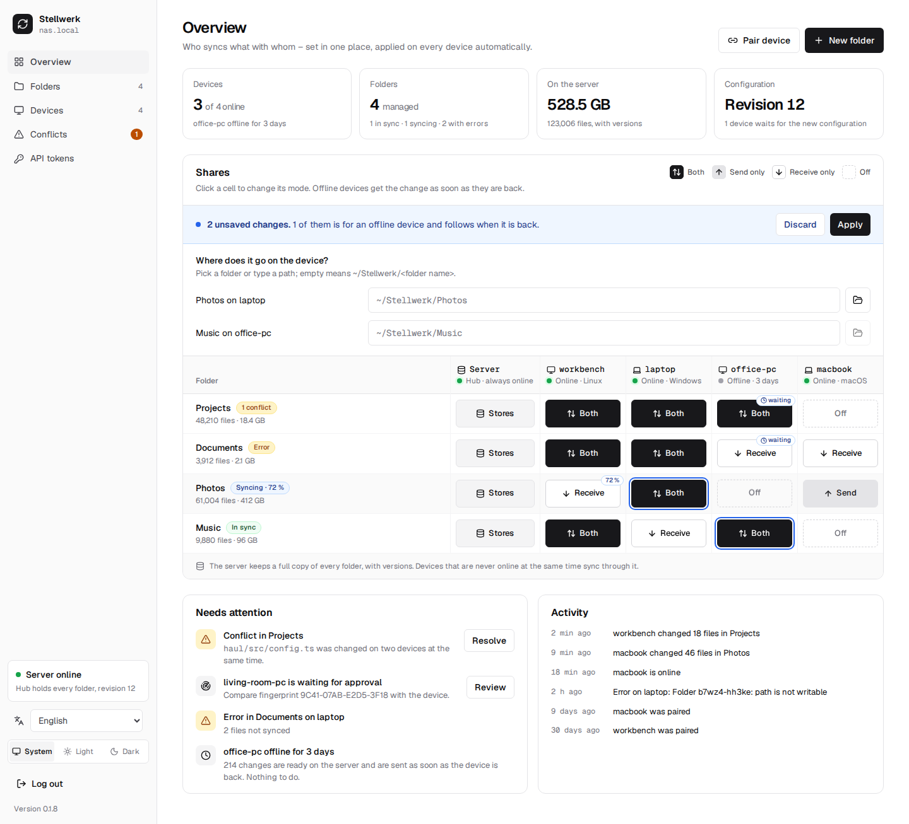
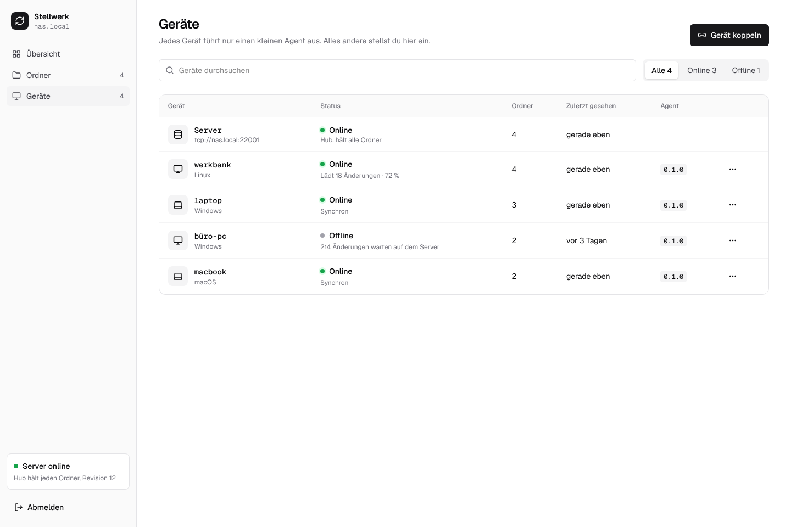
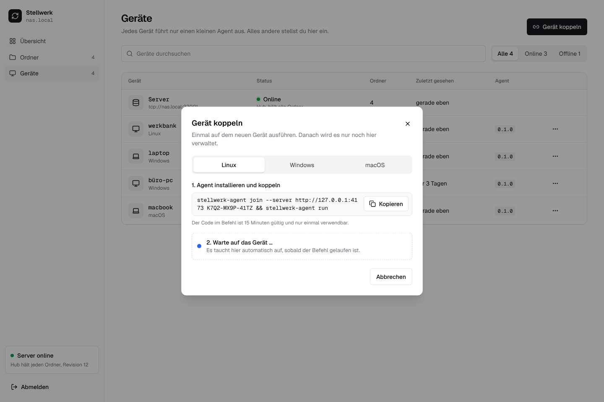
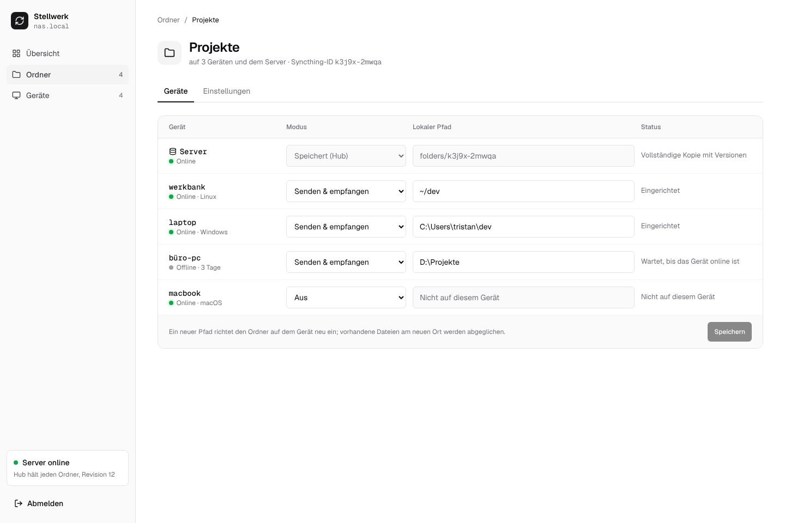
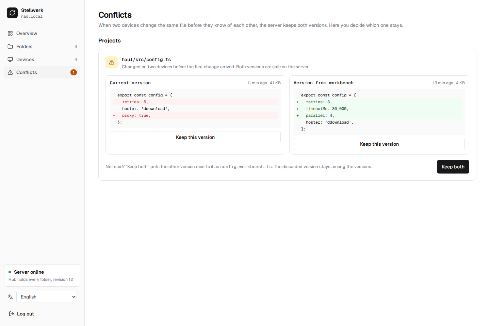

# User guide

What every part of the web UI does, and what happens on the devices when you use it. The UI is in
English and German; it follows the browser's language, and the selector at the bottom of the
sidebar switches it (the choice is kept in the browser).

## Concepts

**Folder.** A set of files that Stellwerk keeps in sync, like `Documents` or `Photos`. Each
folder is one Syncthing folder with a fixed ID. On each device it can live at a different path.

**Device.** A computer with the agent, paired with the Zentrale. The server itself is not a
device in this sense; it is the **hub** (the column **Server** in the overview).

**Share.** Whether a folder is on a device, and how. Every share has a **mode** and a **local
path**:

| Mode | On the device | Syncthing folder type |
|---|---|---|
| **Both** | changes go out and come in | Send & Receive |
| **Send only** | changes on the device go out; changes from elsewhere are not applied there | Send Only |
| **Receive only** | changes from elsewhere come in; local changes stay local and are not sent | Receive Only |
| **Off** | the folder is not on the device | – |

**Hub.** The hub Syncthing on the server is in every folder, always in mode Both, and keeps old
versions of changed and deleted files (a year by default). Devices only sync with the hub, never
with each other directly: the hub forwards a change from one device to all others. That is why a
device that was off for a week still gets everything when it is back, even if the device that
made the change is off by then.

**Revision.** Every change you make (a share, a path, a new folder, a blocked device) raises the
configuration's revision number by one. Each device reports which revision it has applied, so the
UI can tell you which devices still wait for a change.

**Desired state.** From the revision, the Zentrale computes for each device the complete
configuration it should have: its folders, their modes and paths, the hub as its peer. The agent
makes its Syncthing match that. A device that was offline simply gets the newest desired state;
nothing is replayed step by step.

## Logging in

There is one admin account. Its password is set on the server with `stellwerk set-password`
(see [Installation](installation.md)); the login page reminds you if none is set yet. A login
lasts 30 days. **Log out** is at the bottom of the sidebar. Setting a new password logs out every
session; a page whose session has ended takes you back to the login. The box above the language
switch says whether the live link to the server is up (**Server online**) or being re-established.

## Overview



### The cards at the top

| Card | Shows |
|---|---|
| **Devices** | how many devices are online; which device has been offline the longest |
| **Folders** | how many folders, how many are in sync, syncing or have errors |
| **On the server** | how much the hub holds, in bytes and files (the versions come on top) |
| **Configuration** | the current revision, and how many devices have not applied it yet |

### The matrix

One row per folder, one column per device, plus the column **Server** on the left of the
devices.

- **Click a cell** to switch its mode. Each click moves on: Off → Both → Send only → Receive
  only → Off.
- **Changes are a draft.** They collect in a blue bar ("2 unsaved changes"). **Apply** sends all
  of them as one new revision; **Discard** forgets them. Leaving the page keeps nothing.
- **The column Server cannot be switched.** The hub holds every folder; its cells say
  **Stores**.
- **waiting** on a cell means the device is offline and has not applied the current revision
  yet. It gets the change, and then the files, as soon as it is back. Nothing else to do.
- **A percentage** on a cell (e.g. `72 %`) means that device is receiving that folder right now.
- **Under the folder name**: its size, and a badge: *In sync*, *Syncing · 72 %*, *Error*, or the
  number of open conflicts.
- **Under the device name**: online or how long offline, and its operating system.

A new share gets the path `~/Stellwerk/<folder name>` on the device. Change it on the folder page
before or after the files arrive, typed or picked with the folder button.

### Needs attention

Things that may need you, most important first, each with a button to the place where you
handle it:

- **Conflict in …**: a file was changed on two devices at the same time ([Conflicts](#conflicts)).
- **… is waiting for approval**: a device in the LAN wants to pair without a code
  ([Waiting devices](#waiting-devices)).
- **Error in … on …**: Syncthing reports files it could not sync on a device, e.g. because a path
  is not writable.
- **… offline for …**: with how many changes wait for the device on the server. That is only
  information; they are sent when it is back.
- **… never connected**: a device was created but its agent has never signed in.

### Activity

What happened recently: devices paired, coming online and going offline, files changed
("laptop changed 18 files in Projects", counted over 30 seconds), conflicts found and resolved,
versions restored, and errors.

### Live updates

The UI keeps a connection to the Zentrale and updates itself within a second when something
changes; no reloading needed. The box at the bottom of the sidebar says whether the server is
online and which revision it has.

## Devices



The list of all paired devices with their state, the folders they hold, the agent and Syncthing
version, and when they were last seen. Search by name and filter by online or offline.

| Action | What it does |
|---|---|
| **Rename** | changes the name in Stellwerk only; the device's host name stays |
| **Block** | the device gets no folders any more and the hub stops syncing with it; its agent is turned away. Its files stay on the device. **Unblock** brings everything back |
| **Remove …** | deletes the device from Stellwerk. The hub forgets it, its folders stop syncing; its files stay. To use it again, pair it again |

### Pair device



1. **Pair device** (also in the overview). Pick the device's operating system.
2. Copy the command and run it in a terminal on the device as the normal user. It downloads the
   agent, pairs it and starts it, and contains a **one-time code** that is valid for 15 minutes
   and works once:

    ```bash
    curl -fsSL https://github.com/firsttris/stellwerk/releases/download/vX.Y.Z/install.sh | sh -s -- https://sync.example.org K7Q2-MX9P-41TZ
    ```

    On Windows the command is for PowerShell; the [installer](installation.md#windows-installer)
    also asks for the address and the code. **Install the agent by hand** links to the
    [manual steps](installation.md#by-hand).
3. The dialog waits. As soon as the agent has signed in, it shows the device with its OS, agent
   version and fingerprint, and asks **Which folders should it get?** The chosen folders are
   shared in mode Both with the default path; change that per folder afterwards. When the
   code expires first, the dialog stops waiting and offers **Create a new code**.

**Later** closes the dialog; the device is paired anyway and shows up in the list.

### Waiting devices

In the same network as the Zentrale, a device can pair without a code. `stellwerk-agent join`
(without `--server` and without a code) finds the Zentrale over mDNS and prints the device's
**fingerprint**, e.g. `9C41-07AB-E2D5-3F18`. Once its agent runs, it shows up under **Devices →
Waiting devices**, and in **Needs attention**.

**Approve** only if the fingerprint in the UI is the one printed on the device: anybody in your
network can ask to be paired. **Reject** turns it away until the Zentrale restarts. Waiting
devices are kept in memory only, at most 20, and drop off the list when their agent stops.

## Folders

The list of all folders with their size, state and how many devices hold them. **New folder**
creates one: it is on the server right away. Pick a **device** and its folder with the folder
button (or type the path) and the folder is on that device too, in mode Both; the name follows
the folder you picked. With **Only on the server for now** it is on no device until you share it
in the matrix (or when pairing a device).

### Picking a folder on a device

The folder button next to a path opens the device's folders: the Zentrale asks the agent, which
lists the subdirectories of one directory at a time, starting in the home directory. **Up one
level**, **Home folder**, the drives on Windows, or a path typed into the field and Enter move
around; **Choose this folder** takes the one shown. Only folder names leave the device, never
files. The button is off while the device is offline, and an agent older than v0.1.6 does not
answer; type the path then.

### Folder page



**Devices** tab: one row per device.

- **Mode**: the same choice as in the matrix.
- **Local path**: where the folder is on that device, typed or picked with the folder button.
  `~` is the user's home directory, on Windows too. A new path sets the folder up again on the device: Syncthing scans the new place,
  keeps files that are already there and fetches the rest. The files at the old path stay where
  they are; Stellwerk never moves or deletes them.
- **Status**: in sync, syncing with progress, errors, or how much waits for an offline device.

Changes to modes and paths collect until you click **Save**, which applies them as one revision.

The row **Server** shows the hub's full copy with versions.

**Versions** tab: every file the hub has older versions of, with a search. When a
device changes or deletes a file, the hub keeps the previous version. **Restore** puts the chosen
version back as the current file; the file it replaces becomes a version itself, so a restore
can be undone. The devices get the restored file with the next sync.

**Conflicts** tab: the open conflicts of this folder ([Conflicts](#conflicts)).

### Settings: rename, ignore patterns, remove

- **Rename** changes the folder's label everywhere. Paths and the Syncthing ID stay.
- **Ignore**: files that should not be synced, one pattern per line, the same on every device
  and on the server. The syntax is Syncthing's
  ([ignoring files](https://docs.syncthing.net/users/ignoring.html)), for example:

    ```
    node_modules/
    target/
    *.log
    .DS_Store
    ```

    Ignored files are not deleted where they exist; they just stop being synced.
- **Versions on the server** shows how long the hub keeps old versions.
- **Remove folder** stops syncing it everywhere and removes it from the server's configuration.
  The files on the devices and on the server stay.

## Conflicts



A conflict happens when two devices change the same file before either has seen the other's
change. Syncthing then keeps both: the version that won keeps the name, the other becomes a
*conflict copy* (`config.sync-conflict-20261012-103112-WORKBEN.ts`). Stellwerk finds those copies
on the server and lists them here, grouped by folder, with both sides next to each other and a
line diff for text files up to 256 KB and 2,000 lines. When the current file was deleted, the
copy is shown in full.

| Choice | Result |
|---|---|
| **Keep this version** (left, current) | the copy is removed; it goes to the versions |
| **Keep this version** (right, the copy) | the copy takes the file's name; the current file goes to the versions |
| **Keep both** | the copy is renamed to `name.<device>.ext` next to the file, e.g. `config.workbench.ts` |

The change is made on the server and synced to every device from there. Nothing is lost: a
discarded side can be restored from the **Versions** tab.

## What happens on a device

- The agent runs in the background as the user who installed it, without admin rights
  ([Installation](installation.md#running-in-the-background)).
- It has its **own Syncthing**, with its own configuration and ports, in its data directory. A
  Syncthing you already use is not touched; the two run side by side.
- Its Syncthing talks only to the hub. Devices need no open port; they dial out to the server.
- When the configuration changes, the agent changes its Syncthing's configuration: adds,
  changes or removes folders. It never deletes files. A folder that is switched to **Off** stops
  syncing and its files stay on disk.
- Devices keep no versions themselves; the server does.
