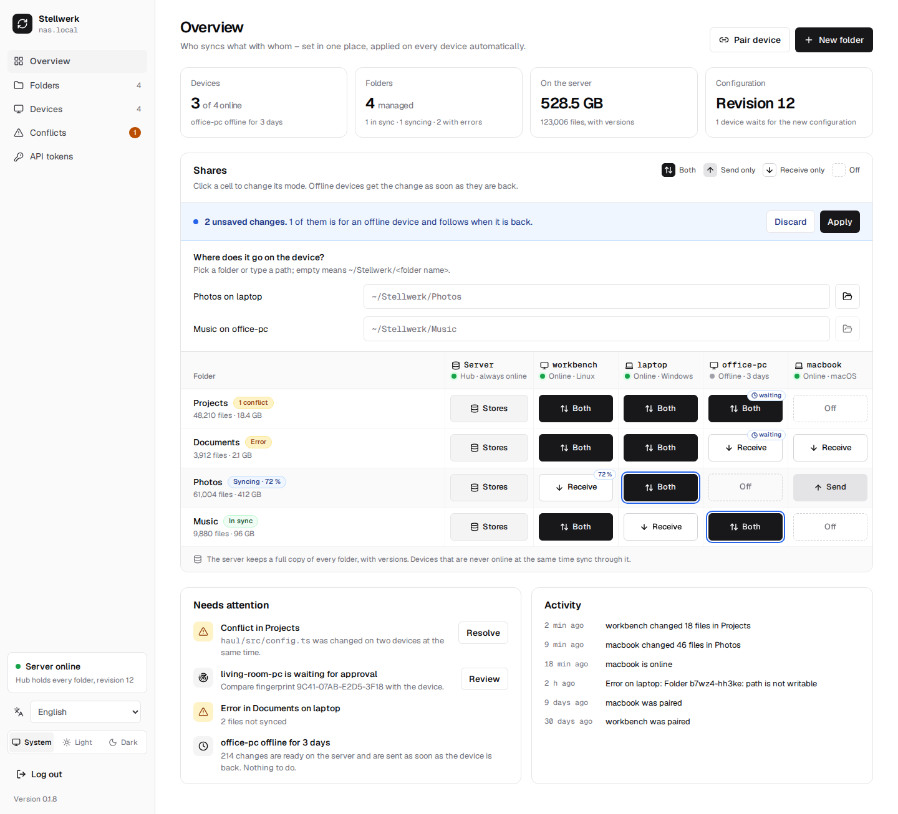
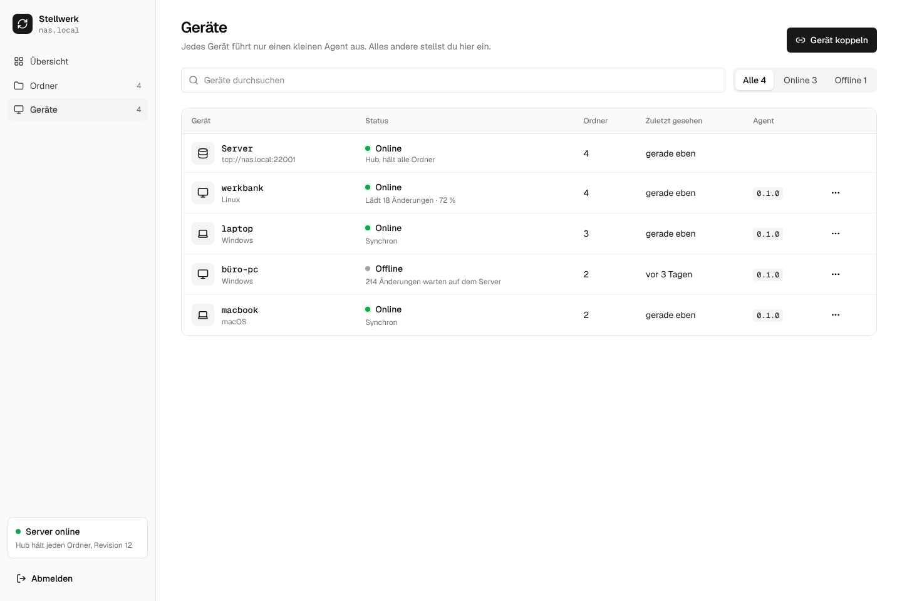
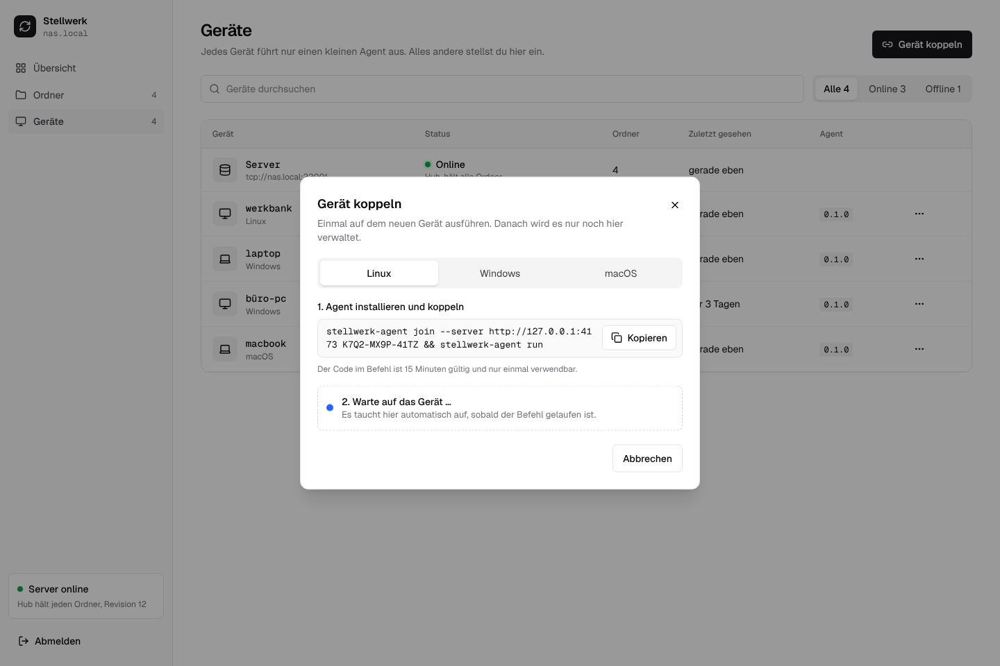
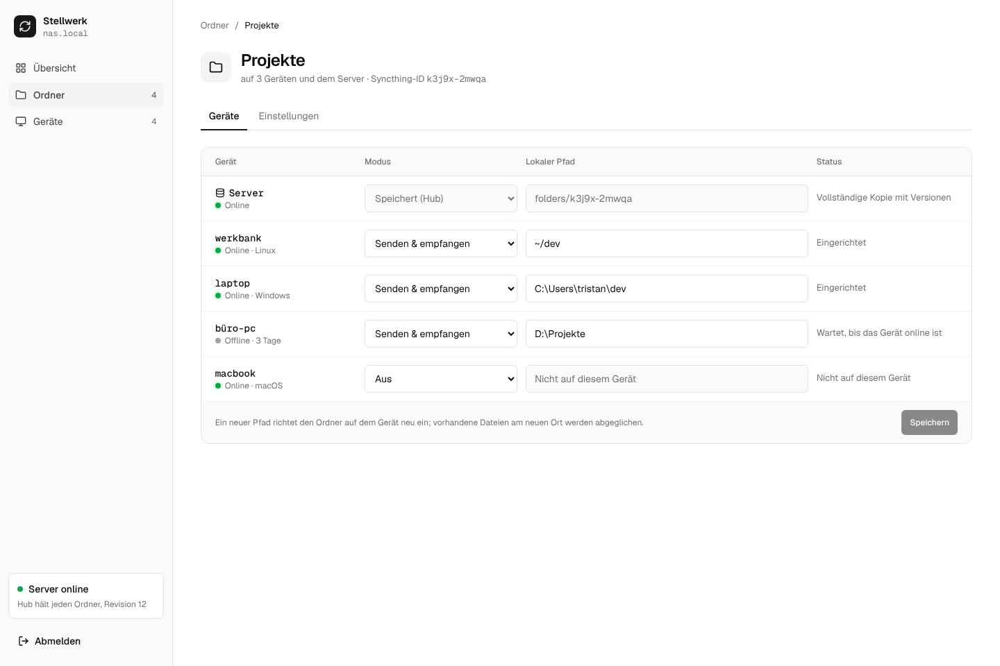
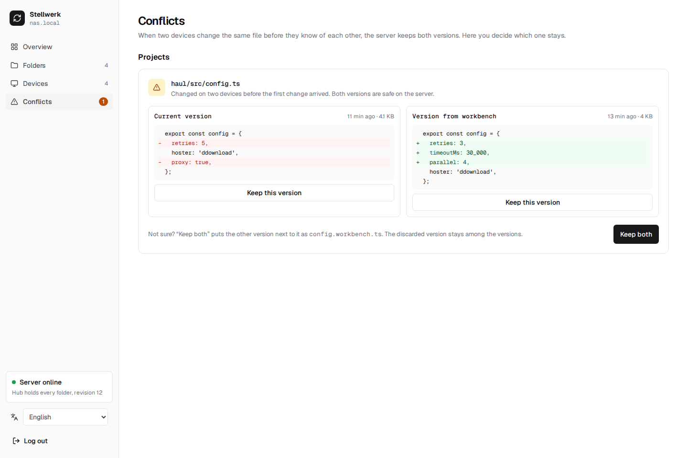

# Bedienung

Was jeder Teil der Weboberfläche tut und was auf den Geräten passiert, wenn du ihn benutzt. Die
Oberfläche gibt es auf Deutsch und Englisch; sie folgt der Sprache des Browsers, und die Auswahl
unten in der Seitenleiste wechselt sie (die Wahl merkt sich der Browser). Darunter wählen
**System**, **Hell** und **Dunkel** die Darstellung auf dieselbe Weise: **System** folgt dem
Betriebssystem. Die unterste Zeile der Seitenleiste zeigt die Version der installierten Zentrale.

## Begriffe

**Ordner.** Eine Menge von Dateien, die Stellwerk abgleicht, etwa `Dokumente` oder `Fotos`. Jeder
Ordner ist ein Syncthing-Ordner mit einer festen ID. Auf jedem Gerät kann er unter einem anderen
Pfad liegen.

**Gerät.** Ein Rechner mit dem Agenten, gekoppelt mit der Zentrale. Der Server selbst ist in
diesem Sinn kein Gerät; er ist der **Hub** (die Spalte **Server** in der Übersicht).

**Freigabe.** Ob ein Ordner auf einem Gerät ist, und wie. Jede Freigabe hat einen **Modus** und
einen **lokalen Pfad**:

| Modus | Auf dem Gerät | Syncthing-Ordnertyp |
|---|---|---|
| **Beides** | Änderungen gehen hinaus und kommen herein | Send & Receive |
| **Nur senden** | Änderungen auf dem Gerät gehen hinaus; Änderungen von anderswo werden dort nicht übernommen | Send Only |
| **Nur empfangen** | Änderungen von anderswo kommen herein; lokale Änderungen bleiben lokal und werden nicht gesendet | Receive Only |
| **Aus** | der Ordner ist nicht auf dem Gerät | – |

**Hub.** Das Hub-Syncthing auf dem Server ist in jedem Ordner, immer im Modus Beides, und behält
alte Versionen geänderter und gelöschter Dateien (standardmäßig ein Jahr). Die Geräte gleichen nur
mit dem Hub ab, nie direkt untereinander: Der Hub leitet eine Änderung von einem Gerät an alle
anderen weiter. Deshalb bekommt ein Gerät, das eine Woche aus war, trotzdem alles, sobald es
wieder an ist, auch wenn das Gerät, das die Änderung gemacht hat, inzwischen aus ist.

**Revision.** Jede Änderung, die du machst (eine Freigabe, ein Pfad, ein neuer Ordner, ein
gesperrtes Gerät), erhöht die Revisionsnummer der Konfiguration um eins. Jedes Gerät meldet,
welche Revision es angewendet hat, so kann die Oberfläche dir sagen, welche Geräte noch auf eine
Änderung warten.

**Soll-Zustand.** Aus der Revision berechnet die Zentrale für jedes Gerät die vollständige
Konfiguration, die es haben soll: seine Ordner, deren Modi und Pfade, den Hub als Gegenstelle. Der
Agent bringt sein Syncthing auf diesen Stand. Ein Gerät, das offline war, bekommt einfach den
neuesten Soll-Zustand; nichts wird Schritt für Schritt nachgespielt.

## Anmelden

Es gibt ein Admin-Konto. Sein Passwort wird auf dem Server mit `stellwerk set-password` gesetzt
(siehe [Installation](installation.md)); die Anmeldeseite erinnert dich daran, wenn noch keins
gesetzt ist. Eine Anmeldung gilt 30 Tage. **Abmelden** steht unten in der Seitenleiste. Ein neues
Passwort meldet jede Sitzung ab; eine Seite, deren Sitzung abgelaufen ist, führt dich zurück zur
Anmeldung. Der Kasten über der Sprachauswahl zeigt, ob die Live-Verbindung zum Server steht
(**Server online**) oder gerade neu aufgebaut wird.

## Übersicht { #overview }



### Die Karten oben

| Karte | Zeigt |
|---|---|
| **Geräte** | wie viele Geräte online sind; welches Gerät am längsten offline ist |
| **Ordner** | wie viele Ordner es gibt, wie viele synchron sind, gerade laufen oder Fehler haben |
| **Auf dem Server** | wie viel der Hub hält, in Bytes und Dateien (die Versionen kommen dazu) |
| **Konfiguration** | die aktuelle Revision und wie viele Geräte sie noch nicht angewendet haben |

### Die Matrix { #the-matrix }

Eine Zeile pro Ordner, eine Spalte pro Gerät, dazu die Spalte **Server** links von den Geräten.

- **Klicke auf eine Zelle**, um ihren Modus zu wechseln. Jeder Klick geht weiter: Aus → Beides →
  Nur senden → Nur empfangen → Aus.
- **Änderungen sind ein Entwurf.** Sie sammeln sich in einer blauen Leiste („2 ungespeicherte
  Änderungen.“). **Anwenden** schickt alle als eine neue Revision hinaus; **Verwerfen** vergisst
  sie. Verlässt du die Seite, bleibt nichts davon erhalten.
- **Die Spalte Server lässt sich nicht umschalten.** Der Hub hält jeden Ordner; seine Zellen
  zeigen **Speichert**.
- **wartet** in einer Zelle heißt: Das Gerät ist offline und hat die aktuelle Revision noch nicht
  angewendet. Es bekommt die Änderung und dann die Dateien, sobald es wieder da ist. Sonst ist
  nichts zu tun.
- **Eine Prozentzahl** in einer Zelle (z. B. `72 %`) heißt, dass dieses Gerät den Ordner gerade
  empfängt.
- **Unter dem Ordnernamen**: seine Größe und ein Abzeichen: *Synchron*, *Läuft · 72 %*,
  *Fehler* oder die Zahl der offenen Konflikte.
- **Unter dem Gerätenamen**: online oder wie lange offline, und sein Betriebssystem.

Eine Zelle, die einen Ordner zum ersten Mal auf ein Gerät bringt, fragt unter dem Entwurf **Wo
soll es auf dem Gerät liegen?**: Wähle den Ordner dort mit dem Ordner-Knopf oder tippe einen Pfad
ein. Bleibt das Feld leer, ist der Pfad `~/Stellwerk/<Ordnername>`. Ändern kannst du ihn später
auf der Ordnerseite.

### Braucht Aufmerksamkeit

Dinge, die dich brauchen könnten, das Wichtigste zuerst, jeweils mit einem Knopf zu der Stelle, an
der du es erledigst:

- **Konflikt in …**: Eine Datei wurde auf zwei Geräten gleichzeitig geändert
  ([Konflikte](#conflicts)).
- **… wartet auf Freigabe**: Ein Gerät im LAN will sich ohne Code koppeln
  ([Wartende Geräte](#waiting-devices)).
- **Fehler in … auf …**: Syncthing meldet Dateien, die es auf einem Gerät nicht abgleichen konnte,
  z. B. weil ein Pfad nicht beschreibbar ist.
- **… seit … offline**: mit der Zahl der Änderungen, die auf dem Server auf das Gerät warten. Das
  ist nur eine Information; sie werden gesendet, sobald es wieder da ist.
- **… noch nie verbunden**: Ein Gerät wurde angelegt, aber sein Agent hat sich nie angemeldet.

### Aktivität

Was zuletzt passiert ist: Geräte gekoppelt, online und offline gegangen, Dateien geändert
(„Laptop hat 18 Dateien in Projekte geändert“, gezählt über 30 Sekunden), Konflikte gefunden und
gelöst, Versionen wiederhergestellt, und Fehler.

### Live-Aktualisierung

Die Oberfläche hält eine Verbindung zur Zentrale und aktualisiert sich innerhalb einer Sekunde,
wenn sich etwas ändert; neu laden ist nicht nötig. Der Kasten unten in der Seitenleiste zeigt, ob
der Server online ist und welche Revision er hat.

## Geräte



Die Liste aller gekoppelten Geräte mit ihrem Zustand, den Ordnern, die sie halten, der Version von
Agent und Syncthing und wann sie zuletzt gesehen wurden. Suche nach Namen und filtere nach online
oder offline.

| Aktion | Was sie tut |
|---|---|
| **Umbenennen** | ändert den Namen nur in Stellwerk; der Hostname des Geräts bleibt |
| **Sperren** | das Gerät bekommt keine Ordner mehr und der Hub gleicht nicht mehr mit ihm ab; sein Agent wird abgewiesen. Seine Dateien bleiben auf dem Gerät. **Entsperren** bringt alles zurück |
| **Entfernen …** | löscht das Gerät aus Stellwerk. Der Hub vergisst es, seine Ordner werden nicht mehr abgeglichen; seine Dateien bleiben. Um es wieder zu nutzen, koppel es neu |

### Gerät koppeln { #pair-device }



1. **Gerät koppeln** (auch in der Übersicht). Wähle das Betriebssystem des Geräts.
2. Kopiere den Befehl und führe ihn auf dem Gerät in einem Terminal als normaler Benutzer aus. Er
   lädt den Agenten herunter, koppelt ihn und startet ihn, und er enthält einen **Einmal-Code**,
   der 15 Minuten gilt und einmal funktioniert:

    ```bash
    curl -fsSL https://github.com/Speicherstadt/stellwerk/releases/download/vX.Y.Z/install.sh | sh -s -- https://sync.example.org K7Q2-MX9P-41TZ
    ```

    Unter Windows ist der Befehl für PowerShell; der [Installer](installation.md#windows-installer)
    fragt ebenfalls nach Adresse und Code. **Agent von Hand installieren** verlinkt die
    [Schritte von Hand](installation.md#by-hand).
3. Der Dialog wartet. Sobald sich der Agent angemeldet hat, zeigt er das Gerät mit Betriebssystem,
   Version des Agenten und Fingerabdruck und fragt **Welche Ordner soll es bekommen?** Die
   gewählten Ordner werden im Modus Beides freigegeben; wähle für jeden mit dem Ordner-Knopf, wo
   er auf dem Gerät liegen soll, oder lass das Feld leer für `~/Stellwerk/<Ordnername>`. Läuft
   der Code vorher ab, hört der Dialog auf zu warten und bietet **Neuen Code erzeugen** an.

**Später** schließt den Dialog; das Gerät ist trotzdem gekoppelt und erscheint in der Liste.

### Wartende Geräte { #waiting-devices }

Im selben Netz wie die Zentrale kann sich ein Gerät ohne Code koppeln. `stellwerk-agent join`
(ohne `--server` und ohne Code) findet die Zentrale über mDNS und zeigt den **Fingerabdruck** des
Geräts, z. B. `9C41-07AB-E2D5-3F18`. Sobald sein Agent läuft, erscheint es unter **Geräte →
Wartende Geräte** und unter **Braucht Aufmerksamkeit**.

**Freigeben** nur, wenn der Fingerabdruck in der Oberfläche der ist, den das Gerät gezeigt hat:
Jeder in deinem Netz kann darum bitten, gekoppelt zu werden. **Ablehnen** weist es ab, bis die
Zentrale neu startet. Wartende Geräte werden nur im Speicher gehalten, höchstens 20, und fallen
aus der Liste, wenn ihr Agent stoppt.

## Ordner

Die Liste aller Ordner mit ihrer Größe, ihrem Zustand und wie viele Geräte sie halten. **Neuer
Ordner** legt einen an: Er ist sofort auf dem Server. Wähle ein **Gerät** und seinen Ordner mit
dem Ordner-Knopf (oder tippe den Pfad ein), und der Ordner ist auch auf diesem Gerät, im Modus
Beides; der Name folgt dem gewählten Ordner. Mit **Erst nur auf dem Server** ist er auf keinem
Gerät, bis du ihn in der Matrix freigibst (oder beim Koppeln eines Geräts).

### Einen Ordner auf einem Gerät auswählen { #picking-a-folder-on-a-device }

Der Ordner-Knopf neben einem Pfad öffnet die Ordner des Geräts: Die Zentrale fragt den Agenten,
der die Unterverzeichnisse jeweils eines Verzeichnisses auflistet, beginnend im Home-Verzeichnis.
**Eine Ebene höher**, **Persönlicher Ordner**, die Laufwerke unter Windows oder ein ins Feld
getippter Pfad mit Enter bewegen dich herum; **Diesen Ordner wählen** übernimmt den angezeigten.
Nur Ordnernamen verlassen das Gerät, nie Dateien. Der Knopf ist aus, solange das Gerät offline
ist, und ein Agent älter als v0.1.6 antwortet nicht; tippe den Pfad dann ein.

### Ordnerseite { #folder-page }



Reiter **Geräte**: eine Zeile pro Gerät.

- **Modus**: dieselbe Wahl wie in der Matrix.
- **Lokaler Pfad**: wo der Ordner auf diesem Gerät liegt, eingetippt oder mit dem Ordner-Knopf
  gewählt. `~` ist das Home-Verzeichnis des Benutzers, auch unter Windows. Ein neuer Pfad richtet
  den Ordner auf dem Gerät neu ein: Syncthing durchsucht den neuen Ort, behält Dateien, die schon
  dort liegen, und holt den Rest. Die Dateien am alten Pfad bleiben, wo sie sind; Stellwerk
  verschiebt oder löscht sie nie.
- **Status**: synchron, läuft mit Fortschritt, Fehler, oder wie viel auf ein Gerät wartet, das
  offline ist.

Änderungen an Modi und Pfaden sammeln sich, bis du auf **Speichern** klickst; das wendet sie als
eine Revision an.

Die Zeile **Server** zeigt die vollständige Kopie des Hubs mit Versionen.

Reiter **Versionen**: jede Datei, von der der Hub ältere Versionen hat, mit einer Suche. Wenn ein
Gerät eine Datei ändert oder löscht, behält der Hub die vorige Version. **Wiederherstellen** setzt
die gewählte Version als aktuelle Datei zurück; die Datei, die sie ersetzt, wird selbst zu einer
Version, so lässt sich ein Wiederherstellen rückgängig machen. Die Geräte bekommen die
wiederhergestellte Datei beim nächsten Abgleich.

Reiter **Konflikte**: die offenen Konflikte dieses Ordners ([Konflikte](#conflicts)).

### Einstellungen: umbenennen, Ignoriermuster, entfernen { #settings-rename-ignore-patterns-remove }

- **Umbenennen** ändert die Bezeichnung des Ordners überall. Pfade und die Syncthing-ID bleiben.
- **Ignorieren**: Dateien, die nicht abgeglichen werden sollen, ein Muster pro Zeile, auf jedem
  Gerät und auf dem Server gleich. Die Syntax ist die von Syncthing
  ([Ignoring Files](https://docs.syncthing.net/users/ignoring.html)), zum Beispiel:

    ```
    node_modules/
    target/
    *.log
    .DS_Store
    ```

    Ignorierte Dateien werden dort, wo sie liegen, nicht gelöscht; sie werden nur nicht mehr
    abgeglichen.
- **Ausnahmen anderer Programme** erscheinen hier nicht: Ein Programm auf einem Gerät, das manche
  Dateien selbst überträgt (zum Beispiel [Spielstand](https://github.com/firsttris/spielstand)
  mit Spielständen), bittet den Agenten auf diesem Gerät, genau diese Dateien in Ruhe zu lassen
  ([Referenz](reference.md#exclusions-from-other-programs)).
- **Versionen auf dem Server** zeigt, wie lange der Hub alte Versionen behält.
- **Ordner entfernen** beendet den Abgleich überall und entfernt ihn aus der Konfiguration des
  Servers. Die Dateien auf den Geräten und auf dem Server bleiben.

## Konflikte { #conflicts }



Ein Konflikt entsteht, wenn zwei Geräte dieselbe Datei ändern, bevor eines die Änderung des
anderen gesehen hat. Syncthing behält dann beide: Die Fassung, die gewonnen hat, behält den Namen,
die andere wird zur *Konfliktkopie* (`config.sync-conflict-20261012-103112-WORKBEN.ts`). Stellwerk
findet diese Kopien auf dem Server und listet sie hier auf, nach Ordner gruppiert, mit beiden
Seiten nebeneinander und einem zeilenweisen Diff für Textdateien bis 256 KB und 2.000 Zeilen. Wurde
die aktuelle Datei gelöscht, wird die Kopie vollständig gezeigt.

| Wahl | Ergebnis |
|---|---|
| **Diese Fassung behalten** (links, aktuell) | die Kopie wird entfernt; sie kommt in die Versionen |
| **Diese Fassung behalten** (rechts, die Kopie) | die Kopie bekommt den Namen der Datei; die aktuelle Datei kommt in die Versionen |
| **Beide behalten** | die Kopie wird neben der Datei in `name.<gerät>.ext` umbenannt, z. B. `config.workbench.ts` |

Die Änderung geschieht auf dem Server und wird von dort auf jedes Gerät abgeglichen. Nichts geht
verloren: Eine verworfene Seite lässt sich im Reiter **Versionen** wiederherstellen.

## API-Tokens { #api-tokens }

**API-Tokens** in der Seitenleiste: Tokens für Skripte und KI-Assistenten wie Claude Code. Gib
einem Token einen Namen (wo es benutzt wird) und einen Umfang und klicke auf **Token erstellen**.
Das Token (`stw_…`) wird nur dieses eine Mal gezeigt; kopiere es dann. Gespeichert wird nur sein
Hash, ein verlorenes Token lässt sich also nicht noch einmal anzeigen: Widerrufe es und erstelle
ein neues.

| Umfang | Darf |
|---|---|
| **Lesen** | die Übersicht, den Live-Status, die Aktivität und die Ordner auf einem Gerät (die Ordnerauswahl) |
| **Verwalten** | außerdem Ordner anlegen und umbenennen, Ignoriermuster setzen und Freigaben anwenden |

Geräte entfernen oder sperren, Koppeln, Ordner löschen, Konflikte, Versionen und die Tokens selbst
brauchen die Anmeldung im Browser, egal mit welchem Umfang. Die Liste zeigt, wann jedes Token
erstellt und zuletzt benutzt wurde. **Widerrufen** weist es sofort ab. Ein neues Admin-Passwort
widerruft jedes Token.

Ein Token wird als `Authorization: Bearer stw_…` gesendet:

```sh
curl -H "Authorization: Bearer stw_…" https://sync.example.org/api/overview
```

### Claude Code und andere Assistenten (MCP) { #claude-code-and-other-assistants-mcp }

Die Zentrale ist ein [MCP](https://modelcontextprotocol.io)-Server unter `/mcp`, so kann ein
KI-Assistent den Abgleich für dich einrichten: „Synchronisiere Game of Thrones vom NAS auf meinen
Laptop.“ Nach dem Erstellen eines Tokens zeigt die Seite den Befehl, der es zu Claude Code
hinzufügt:

```sh
claude mcp add --transport http --scope user stellwerk https://sync.example.org/mcp \
  --header "Authorization: Bearer stw_…"
```

`claude mcp list` sollte dann `stellwerk … Connected` zeigen. Andere MCP-Clients nehmen dieselbe
URL und denselben Header (Transport „Streamable HTTP“).

| Werkzeug | Tut | Umfang |
|---|---|---|
| `list_devices` | die gekoppelten Geräte, online oder nicht | Lesen |
| `list_folders` | die Ordner mit ihrer Größe auf dem Server und je Gerät Modus, Pfad und Sync-Zustand | Lesen |
| `browse_device` | die Unterverzeichnisse eines Verzeichnisses auf einem Gerät, das online ist, wie die Ordnerauswahl | Lesen |
| `search_device` | Verzeichnisse auf einem Gerät, das online ist, nach Namen („game of thrones“ findet `Game.of.Thrones.S01`), ab dem Home-Verzeichnis oder einem angegebenen Pfad | Lesen |
| `preview_shares` | prüft einen Entwurf aus Modi und Pfaden und beschreibt ihn, mit der Größe des Ordners; ändert nichts | Lesen |
| `create_folder` | ein neuer Ordner auf dem Server | Verwalten |
| `apply_shares` | wendet den Entwurf als eine Revision an, wie **Anwenden** in der Matrix | Verwalten |

Der Assistent ist angewiesen, dir die Vorschau zu zeigen, einschließlich wie viel Platz der Ordner
auf dem Server und auf jedem empfangenden Gerät braucht, bevor er etwas anwendet; Claude Code
fragt außerdem vor jedem Werkzeug, das etwas ändert. Anwenden ändert nur die Konfiguration: Stellt
man einen Ordner auf einem Gerät auf **Aus**, bleiben seine Dateien, wo sie sind. Ein Gerät muss
online sein, damit es durchsucht oder durchblättert werden kann; ein Agent älter als v0.1.10
antwortet nicht auf eine Suche.

## Was auf einem Gerät passiert

- Der Agent läuft im Hintergrund als der Benutzer, der ihn installiert hat, ohne
  Administratorrechte ([Installation](installation.md#running-in-the-background)).
- Er hat sein **eigenes Syncthing** mit eigener Konfiguration und eigenen Ports in seinem
  Datenverzeichnis. Ein Syncthing, das du schon benutzt, wird nicht angefasst; die beiden laufen
  nebeneinander.
- Sein Syncthing spricht nur mit dem Hub. Die Geräte brauchen keinen offenen Port; sie verbinden
  sich nach außen zum Server.
- Ändert sich die Konfiguration, ändert der Agent die Konfiguration seines Syncthing: Er fügt
  Ordner hinzu, ändert oder entfernt sie. Er löscht nie Dateien. Ein Ordner, der auf **Aus**
  gestellt wird, wird nicht mehr abgeglichen, und seine Dateien bleiben auf der Platte.
- Die Geräte behalten selbst keine Versionen; das macht der Server.
